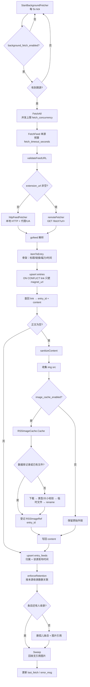
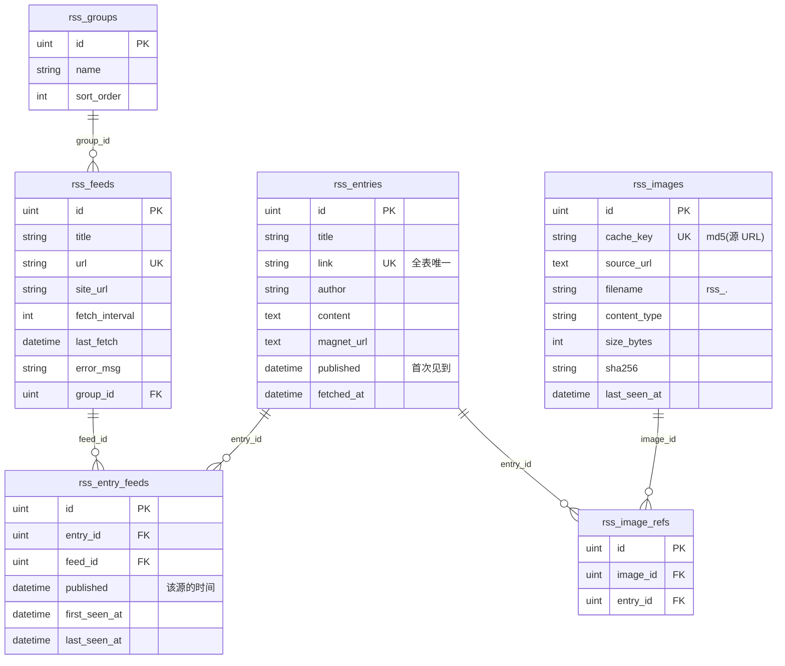
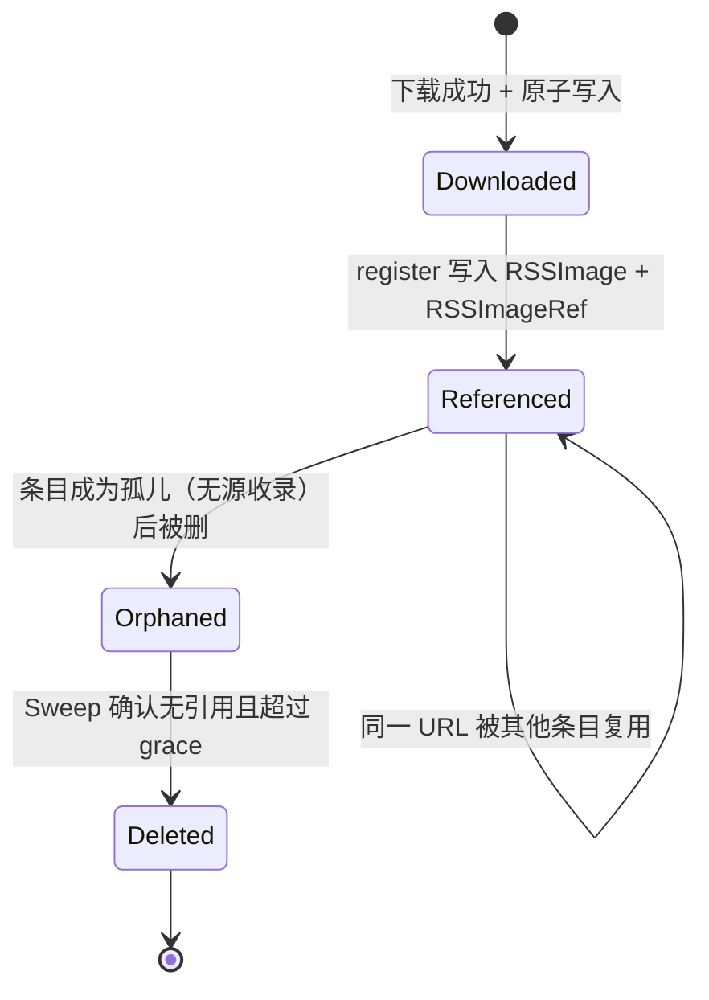

# RSS 抓取机制与资源模型

本文回答三件事：

1. 当前 RSS 抓取是怎么跑的；
2. 数据落在哪些表、彼此是什么关系；
3. 图片缓存为什么会出现“A 源抓过、B 源复用/覆盖”的现象，以及为
   `homehub-extension` 远程预下载预留了哪些接入点。

图使用 Mermaid，GitHub / GitLab / VS Code（装 Mermaid 插件）可直接渲染。

---

## 1. 抓取机制

### 1.1 调度层

`RSSService.StartBackgroundFetcher` 在独立 goroutine 里每 **5 秒**检查一次：

- 读 `rss.background_fetch_enabled` 和 `rss.background_fetch_interval`；
- 配置变化时立即按新配置跑一轮，之后按新间隔调度；
- 到点调用 `FetchAll`。

`FetchAll` 先查出所有订阅源，筛出 `now - last_fetch > fetch_interval` 的
“到期源”，然后用 `fetch_concurrency`（默认 4）个槽并发抓取。每个源有
独立的 `fetch_timeout_seconds`（默认 30s）预算，单个源慢/挂不会拖住整轮。

### 1.2 单源抓取

`FetchFeed(ctx, feedID)`：

1. 查 `rss_feeds`；
2. 复验 feed URL（SSRF 防护）；
3. 通过 `RSSFetcher` 抓取：
   - `rss.extension_url` 为空 → `httpFeedFetcher` 直接 HTTP 拉取；
   - 非空 → `remoteFetcher` 请求 `GET {extension_url}/fetch?url=...`；
4. `gofeed` 解析成 `*gofeed.Feed`；
5. 逐条 `itemToEntry` 构造**不含正文的骨架**（标题、链接、作者、磁力链接）；
6. 骨架批量 `INSERT ... ON CONFLICT (link) DO UPDATE magnet_url`；
7. 查回 `link → (entry_id, content)`，**只为正文为空的条目**清洗 HTML 并缓存图片；
8. 批量 upsert `rss_entry_feeds`（条目归属 + 该源的发布时间）；
9. `enforceRetention` 按本源收录数删关联，孤儿条目才回收；
10. 更新 `last_fetch` / `error_msg` / 标题等元数据。

第 7 步"只为空正文处理"是有意的：同一条内容被 B 源再次抓到时，正文通常
已由 A 源处理过，重复清洗会白下载一遍图片，还可能用 B 的摘要覆盖 A 的全文。

### 1.3 流程图



### 1.4 图片缓存细节

`sanitizeContent` 只负责从 HTML 里收集 ``，真正的下载、校验、
去重、落库、改写都交给 `RSSImageCache`：

- 缓存键：`md5(源 URL)`；
- 文件名：`rss_<md5>.<ext>`；
- 目录：`web/static/uploads/rss_img/`；
- 同一 URL 在多个条目之间共享同一份物理文件；
- 归属关系写在 `rss_image_refs`，指向**条目**而不是源：
  条目本身已跨源共享，图片因此只有一份引用。

下载路径的关键约束：

- 先用 `maxBytes+1` 读取，超过 `rss.image_max_bytes` 直接失败，**不再截断**；
- 校验响应确实是图片：`image/*`，或 `.svg` + 内容含 `<svg`；
- 校验目标地址，默认拒绝回环/内网/云元数据端点；连接层再解析一次并
  直接 dial 已校验的 IP（防 DNS rebinding），重定向逐跳校验；
- 写临时文件 `.rss-*.part`，成功后 `rename`，并发不会读到半截文件；
- 已存在的文件直接复用；升级前没有数据库记录的历史文件也会被“认领”。

超时边界：若 `ctx` 在下载完成前被取消，已下载的文件会留在缓存目录但**不登记
引用**（条目本身也可能没入库）。这类文件不会泄漏：`Sweep` 会在超过
`image_retention_days` 后按“无引用”回收。反过来，如果超时后仍登记引用，
条目却没入库，引用会永久钉住图片、反而无法清理。

---

## 2. 表关系

### 2.1 ER 图



> 条目与图片之间是**直接关联**（`entry_id`），不再经过 `entry_hash`。
> 条目本身已经跨源共享，所以引用只需要指向条目。

### 2.2 关系说明

- 一个分组包含多个订阅源；删除分组时源被移到“未分组”，不会级联删除。
- **条目不归属任何源**：`rss_entries` 只存内容，按 `link` 全表
  唯一；"哪个源收录了它"由 `rss_entry_feeds` 表达，一个条目可以
  被任意多个源收录。
- 删除一个源只删它自己的关联行。条目必须变成孤儿（没有任何关联）才会
  被回收 —— 这就是"删 A 不影响 B"的机制。
- `retention_count` 按关联行计数，每个源各自保留自己的份额。
- 一张图片可以被多个条目引用；最后一条引用被删除后进入“孤儿”状态。

### 2.3 资源生命周期



---

## 3. 条目归属：一条内容，多个源

### 3.1 旧行为（已修复）

旧版 `rss_entries.link` 是单列唯一索引，`feed_id` 直接存在条目上。
两个源收录同一链接时，后抓到的源命中 `ON CONFLICT (link)`，只更新
`magnet_url`，`feed_id` 仍是先抓到的那个：B 的列表里根本看不到这条内容。

### 3.2 现在的模型

```
rss_entries        纯内容，link 全表唯一，不存 feed_id
rss_entry_feeds    (entry_id, feed_id) + 该源的 published
```

同一条内容只存一行，被 N 个源指向：

```
entries:      id=11  link="https://example.com/post/1"  content="<p>全文</p>"
entry_feeds:  (11, A)  published=2026-10-01
              (11, B)  published=2026-10-02
```

列表查询按源或分组过滤时 JOIN 关联表；返回给前端的 `feed_ids` 是数组，
页面上把全部来源列出来。

### 3.3 删除语义（关键约束）

删除 A 源时：

1. 只删 `entry_feeds WHERE feed_id = A`；
2. 用 `NOT EXISTS` 判定孤儿 —— 11 号仍被 B 收录，所以**一行都不删**；
3. 图片引用挂在条目 11 上，条目还在 → 引用还在 → 图片不会被回收。

只有 A、B 都删掉之后，11 号才成为孤儿，才连同图片引用一起删除，随后
`Sweep` 回收没有引用的图片文件。

`retention_count` 同样按"本源收录了多少条"计数，删的是关联行。A 源修剪到
5000 条不会影响 B 源看到的任何内容。

### 3.4 正文冲突

同一链接两个源给出的正文可能不同（一个全文、一个摘要）。当前策略是
**首次写入优先**：条目第一次入库时清洗后的正文被保留，后续源抓到时只更新
`magnet_url`，不覆盖正文。

重复清洗会重新下载一遍图片（即使命中文件缓存），而且摘要覆盖全文是不可逆
的信息损失。

### 3.5 图片文件仍按 URL 全局共享

文件名是 `rss_<md5(源 URL)>.<ext>`，不含 feed_id。同一张图在多个条目之间
共享一份物理文件，靠 `rss_image_refs` 记账。

如果希望物理隔离（每个源各存一份），需要把缓存键改成
`md5(feedID + "\x00" + URL)`。代价是磁盘占用上升、跨源去重失效。

---

## 4. 本次改动

### 4.1 新增表

- `rss_images`：缓存图片的资源记录（cache_key 唯一、文件名、
  Content-Type、大小、sha256、last_seen_at）。
- `rss_image_refs`：图片 ↔ 订阅源/条目的引用关系，
  联合唯一索引 `(image_id, feed_id, entry_hash)`。

### 4.2 新增配置

`config.json` → `rss`：

| 字段 | 默认 | 说明 |
|------|------|------|
| `image_max_bytes` | 10485760 | 单张图片上限，超限直接丢弃，不截断 |
| `image_cleanup_enabled` | true | 是否自动回收无引用图片 |
| `image_retention_days` | 30 | 无引用图片保留天数 |
| `image_cleanup_interval_hours` | 24 | 后台清理间隔 |
| `image_allow_private_hosts` | false | 允许图片源访问内网/回环（会削弱 SSRF 防护） |

### 4.3 升级回填（重要）

升级前已有的缓存文件**只有文件、没有数据库记录**。如果直接开始清理，它们会
因为“无人引用”被当成孤儿删掉，历史条目的图片随即 404。

所以 `StartImageJanitor` 在第一次清理**之前**会执行一次 `BackfillLegacy`：

1. 分批（500 条）扫描 `content` 中包含 `/static/uploads/rss_img/` 的条目；
2. 用正则提取文件名，只处理磁盘上真实存在的文件；
3. `cache_key` 从文件名反解（与当初的 `md5(URL)` 一致），`source_url` 留空；
4. 建立 `RSSImage` 记录和 `RSSImageRef` 引用。

回填幂等、只跑一次（失败下轮重试）。回填后历史文件与正常缓存走同一套
引用计数，不会再被误删。

> 回填不能反推原始图片 URL，所以 `source_url` 为空。这不影响清理判断；
> 如果同一个 URL 将来又被抓取，`cache_key` 会直接命中这条记录。

### 4.4 行为变化

- **条目跨源共享**：`entries` 只存内容，归属移到 `entry_feeds`。删除源
  只删自己的关联行；条目成为孤儿才回收。
- **删除订阅源**：只删本源关联 + 孤儿条目；随后立即回收无引用图片
  （带 1 分钟缓冲，避免和并发抓取打架）。
- **retention 清理**：按本源收录数计数，删关联行；孤儿条目才物理删除
  （旧实现连条目一起软删除，表会无限膨胀）。
- **后台清理**：启动时跑一次，之后每 `image_cleanup_interval_hours` 一次；
  清理“无引用且超过 `image_retention_days`”的图片，以及目录里没有数据库
  记录、mtime 超过保留期的历史文件。
- **引用对账**：每轮清理用一条 `NOT EXISTS` 删除没有对应条目的图片引用。
  条目被删而引用残留时，图片会永远"有引用"、无法回收。
- **进行中保护**：正在解析的缓存键记在内存 pending 集合里，`Sweep` 会跳过
  它们，避免“命中旧文件、引用尚未写入”的窗口被误删。
- **图片下载**：超过上限失败；非图片响应失败；内网地址默认拒绝；
  写临时文件后原子 rename；同一 URL 复用已有文件。图片走独立严格客户端：
  连接层校验解析后的 IP、重定向逐跳校验。
- **图片类型**：扩展名由 Content-Type 决定，不再盲信 URL 后缀。

---

## 5. 给 homehub-extension 远程预下载的适配

### 5.1 已经预留的接口

`internal/service/rss_image_cache.go`：

```go
type RSSImageCache interface {
    Cache(ctx context.Context, entryID uint64, urls []string) map[string]string
    Sweep(ctx context.Context, grace time.Duration) error
}
```

- `Cache` 返回 `sourceURL → 站内 URL`；失败的 URL 不出现在 map 中，
  调用方会删掉对应 `` 标签。
- `Sweep` 负责回收；远程实现可以 no-op，也可以清理 extension 侧缓存。
- `RSSService.SetImageCache` 可以整体替换实现，`RSSService` 其余代码不需要改。
- `LocalImageCache.Adopt` 是给远程预下载的低层登记入口：extension 把图片
  原子写入 HomeHub 缓存目录后，调用 `Adopt(entryID, items)`
  登记资源与引用，后续 `resolve` 会直接命中文件。

### 5.2 建议的 extension 契约（下一步实现）

保持现有 `/fetch` 不变，新增一个**可选的**预取能力：

```
GET {extension_url}/fetch?url=<feed url>
→ 200, 原始 XML / JSON

可选：GET {extension_url}/image?url=<image url>
→ 200, 图片二进制
   Content-Type: image/*
   X-HomeHub-Cache-Key: <sha256 或 md5>
   X-HomeHub-Content-Type: image/jpeg
```

或者批量：

```
POST {extension_url}/prefetch
{"urls": ["https://.../a.jpg", "https://.../b.png"]}
→ {"items":[{"url":"...","key":"...","content_type":"image/jpeg","size":12345}]}
```

推荐采用“**拉取模式**”：extension 预下载并缓存，HomeHub 用
`RSSImageCache` 的远程实现去 extension 拉取二进制，然后走本地
`localImageCache` 的登记/清理逻辑。这样：

- HomeHub 仍然拥有资源的最终归属和清理权；
- extension 不需要直连数据库；
- extension 挂了只会让图片回退到本地下载，不影响条目入库。

不建议“直链模式”（直接把 `` 改成 extension 的公网 URL）：
extension 的可用性、鉴权、缓存淘汰都会变成 HomeHub 页面的一部分，
而且 HomeHub 无法清理这些文件。

### 5.3 远程实现需要遵守的约束

- `Cache` 必须幂等：同一 URL 重复调用返回同一站内 URL；
- 返回的 URL 必须对浏览器可访问（相对路径或同源路径），不要返回带过期
  签名的临时 URL；
- 二进制落盘必须原子写，且校验 Content-Type 与大小；
- 必须登记 `RSSImageRef`（或复用 `localImageCache` 的登记逻辑），否则
  `Sweep` 会把图片当孤儿删掉；
- 不要绕过 `rss.image_max_bytes` 和 SSRF 校验。

### 5.4 当前尚未做的部分

- `RSSFetcher` 只返回 `*gofeed.Feed`，没有携带“extension 已预取哪些图”的
  元数据。要真正做到“抓 feed 的同时预取图片”，下一步需要在 `/fetch`
  响应里增加 `images` 字段（或增加 `/prefetch` 端点），并在 HomeHub 侧
  增加一个可选的 `PrefetchingFetcher` 接口；本次只把图片缓存侧解耦，
  避免在协议未定时猜测字段。
- `image_allow_private_hosts` 只影响图片下载；feed 抓取的 SSRF 校验仍会
  拒绝内网 feed URL。

---

## 6. 已知问题与后续建议

按优先级：

1. **条目 link 全局唯一**：跨源同链接会被先抓到的源吞掉。建议改为
   `(feed_id, link)` 复合唯一键；需要人工迁移，因为仓库禁止启动时
   `DROP INDEX`。
2. **HTML 清洗残留的是样式风险，不是注入风险**：正文解析成 DOM 后按
   标签/属性白名单重建，`script`/`iframe`/`svg` 等整棵删除，`on*`、`style`、
   `srcset` 一律丢弃，链接与图片地址校验协议。剩余问题是白名单标签自身的
   渲染行为（超长表格撑破布局等），属于展示层，不影响安全。
3. **代理场景下的 SSRF 边界**：走 HTTP 代理时，目标域名由代理解析，
   HomeHub 只能校验代理地址，无法知道最终连到哪个 IP。这是使用代理的固有
   代价；需要严格内网隔离时应让代理侧做 ACL，或改用 SOCKS5（拨号目标就是
   目标地址，连接层校验仍然生效）。直连场景下，feed 与图片都会在
   `DialContext` 里重新解析、校验全部 A/AAAA 记录并直接 dial 已校验的 IP。
4. **历史文件回填依赖条目正文**：`BackfillLegacy` 只为“磁盘上存在且被条目
   `content` 引用”的文件建档。未被任何条目引用的历史文件（真孤儿）会在
   首次清理时删除；`content` 被截断到 2000 字符之外、或正文被改写过的引用
   无法回填。回填失败时 janitor 会跳过该轮清理并重试。
5. **`UpdateFeed` 不能把分组清空**：传 `group_id: null` 时不会更新，
   只能改成另一个分组。前端目前没有“移回未分组”的入口。
6. **图片缓存与用户上传共用 `/static/uploads/`**：安全头对两者一视同仁；
   但 `media_assets` 里没有 RSS 图片记录，媒体管理页看不到它们。
   这是有意的（RSS 图片由 `rss_images` 管理），文档需明确。
7. **`cacheDir` 是相对路径**：依赖进程工作目录。Dockerfile 的
   `WORKDIR /app` 下正常；如果从其他目录启动二进制，需要同步调整
   `static` 挂载与工作目录。

---

## 7. 排障速查

- 图片 404：先看 `rss_images` 是否有记录、文件是否在
  `web/static/uploads/rss_img/`；再看 `Sweep` 日志是否把它当孤儿删了。
- 图片不更新：同一 URL 命中已有文件是预期行为；需要强制刷新时删除对应
  文件和记录后重新抓取。
- 磁盘持续增长：确认 `rss.image_cleanup_enabled=true`。`Sweep` 会清理没有
  对应条目的图片引用。仍不下降时检查 `rss_images.last_seen_at`
  是否一直很新（说明仍在被引用）。
- 某个源删了但条目还在：预期行为 —— 其他源仍收录同一内容。查
  `rss_entry_feeds` 看还有哪些 `feed_id`。
- 启动报"RSS 表结构需要手工迁移"：执行
  `docs/migrations/001-rss-shared-entries.sql`，见 [tables.md](tables.md) 第 10 节。
