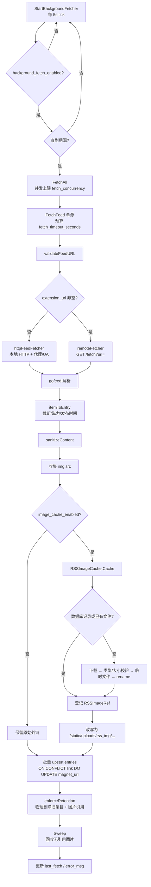
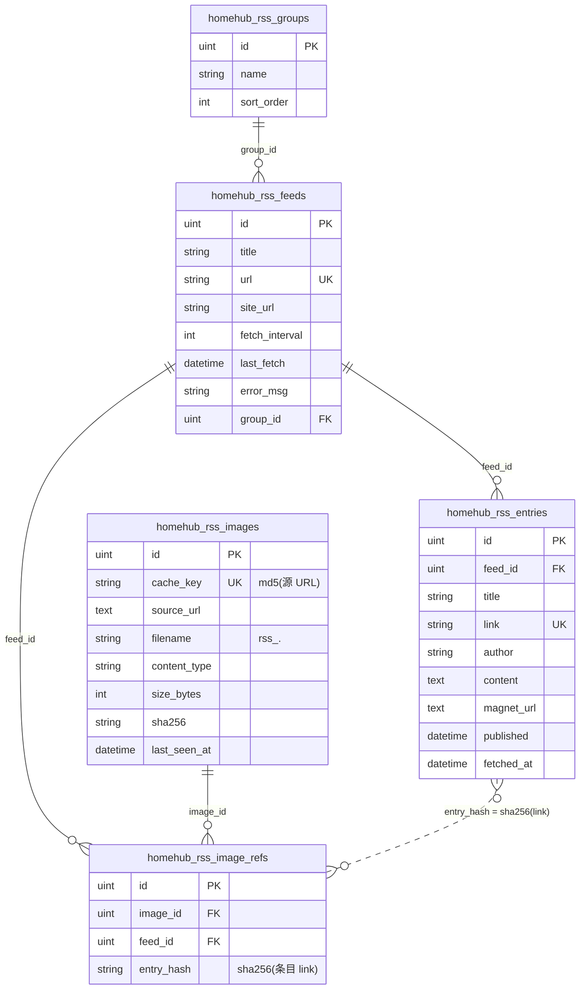
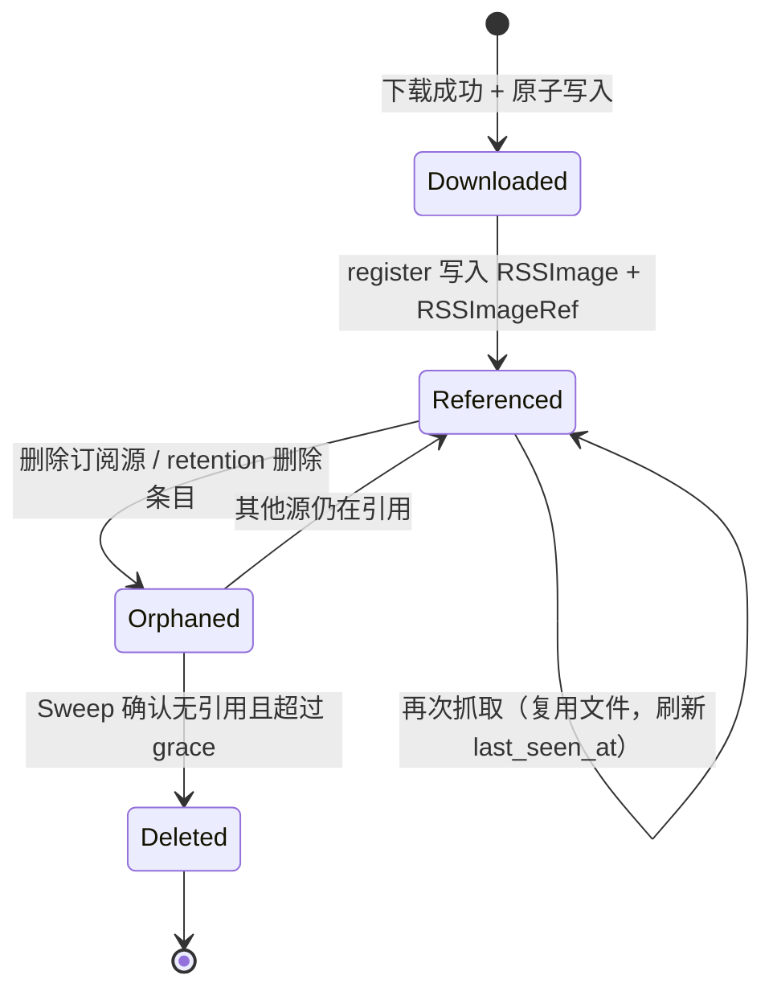

# RSS 抓取机制与资源模型

本文回答三件事：

1. 当前 RSS 抓取是怎么跑的；
2. 数据落在哪些表、彼此是什么关系；
3. 图片缓存为什么会出现“A 源抓过、B 源复用/覆盖”的现象，以及为
   `homehub-extension` 远程预下载预留了哪些接入点。

图使用 Mermaid，GitHub / GitLab / VS Code（装 Mermaid 插件）可直接渲染。

---

## 1. 抓取机制

### 1.1 调度层

`RSSService.StartBackgroundFetcher` 在独立 goroutine 里每 **5 秒**检查一次：

- 读 `rss.background_fetch_enabled` 和 `rss.background_fetch_interval`；
- 配置变化时立即按新配置跑一轮，之后按新间隔调度；
- 到点调用 `FetchAll`。

`FetchAll` 先查出所有订阅源，筛出 `now - last_fetch > fetch_interval` 的
“到期源”，然后用 `fetch_concurrency`（默认 4）个槽并发抓取。每个源有
独立的 `fetch_timeout_seconds`（默认 30s）预算，单个源慢/挂不会拖住整轮。

### 1.2 单源抓取

`FetchFeed(ctx, feedID)`：

1. 查 `homehub_rss_feeds`；
2. 复验 feed URL（SSRF 防护）；
3. 通过 `RSSFetcher` 抓取：
   - `rss.extension_url` 为空 → `httpFeedFetcher` 直接 HTTP 拉取；
   - 非空 → `remoteFetcher` 请求 `GET {extension_url}/fetch?url=...`；
4. `gofeed` 解析成 `*gofeed.Feed`；
5. 逐条 `itemToEntry`：截断内容、提取磁力链接、**清洗 HTML 并缓存图片**；
6. 批量 `INSERT ... ON CONFLICT (link) DO UPDATE magnet_url`；
7. `enforceRetention` 按 `retention_count` 物理删除最旧条目；
8. 删除条目对应的图片引用，回收无引用的图片文件；
9. 更新 `last_fetch` / `error_msg` / 标题等元数据。

### 1.3 流程图



### 1.4 图片缓存细节

`sanitizeContent` 只负责从 HTML 里收集 ``，真正的下载、校验、
去重、落库、改写都交给 `RSSImageCache`：

- 缓存键：`md5(源 URL)`；
- 文件名：`rss_<md5>.<ext>`；
- 目录：`web/static/uploads/rss_img/`；
- 同一 URL 在多个源/条目之间共享同一份物理文件；
- 归属关系写在 `homehub_rss_image_refs`，而不是文件名里。

下载路径的关键约束：

- 先用 `maxBytes+1` 读取，超过 `rss.image_max_bytes` 直接失败，**不再截断**；
- 校验响应确实是图片：`image/*`，或 `.svg` + 内容含 `<svg`；
- 校验目标地址，默认拒绝回环/内网/云元数据端点；
- 写临时文件 `.rss-*.part`，成功后 `rename`，并发不会读到半截文件；
- 已存在的文件直接复用；升级前没有数据库记录的历史文件也会被“认领”。

超时边界：若 `ctx` 在下载完成前被取消，已下载的文件会留在缓存目录但**不登记
引用**（条目本身也可能没入库）。这类文件不会泄漏：`Sweep` 会在超过
`image_retention_days` 后按“无引用”回收。反过来，如果超时后仍登记引用，
条目却没入库，引用会永久钉住图片、反而无法清理。

---

## 2. 表关系

### 2.1 ER 图



> `homehub_rss_entries` 与 `homehub_rss_image_refs` 之间是**逻辑关联**：
> `entry_hash = sha256(entry.link)`，没有数据库外键。这样条目 link 很长时
> 不会把联合唯一索引撑爆，也避免跨表级联删除的复杂度。

### 2.2 关系说明

- 一个分组包含多个订阅源；删除分组时源被移到“未分组”，不会级联删除。
- 一个源包含多个条目；条目按 `link` 全局唯一去重（见“已知问题”）。
- 一张图片可以被多个源、多个条目引用；`RSSImageRef` 每行代表
  “某源的某条目引用过某图”。
- 物理文件只有一份；最后一条引用被删除后，图片进入“孤儿”状态。

### 2.3 资源生命周期



---

## 3. “A 源抓过，B 源被覆盖”到底是什么

这里有**两层**不同的现象，原因不同：

### 3.1 条目层：`link` 全局唯一

`homehub_rss_entries.link` 是全局唯一索引。两个源如果收录了同一个链接
（转载、聚合站、同一篇文章出现在多个 feed），后抓到的条目会命中
`ON CONFLICT (link)`，只更新 `magnet_url`，**不会把 `feed_id` 改成 B**。

结果是：

- A 源先抓到 → 条目归属 A；
- B 源再抓到同一链接 → 条目仍归属 A，B 源的条目列表里看不到它；
- 从 B 源的角度看，就是“被 A 覆盖/吞掉”了。

这是当前表设计的已知限制。彻底修复需要把唯一键从 `(link)` 改为
`(feed_id, link)`，属于破坏性 DDL（删除旧唯一索引），仓库的
`ddl_guard_test.go` 明确禁止启动流程里做 `DROP INDEX`，需要人工迁移。
本次没有动它，建议单独排期。

### 3.2 资源层：文件名全局共享

图片文件名是 `rss_<md5(源 URL)>.<ext>`，**不包含 feed_id**：

- A、B 两个源引用同一张图 → 只有一个物理文件，B 命中 A 下载的文件，
  不会重复下载；
- 源站更新了同一 URL 的图片 → 本地已有文件，仍然复用旧图；
- 删除 A 源 → 以前无法判断这张图是否还被 B 引用，所以只能不删或误删。

本次改造后：

- `RSSImageRef` 记录每个源/条目对图片的引用，删除 A 源只会删 A 的引用；
- 只有“没有任何引用 + 超过保留期”的图片才会被 `Sweep` 删除；
- B 源仍在引用时，文件会保留。

如果你希望**物理隔离**（每个源各存一份，哪怕 URL 相同），需要把缓存键
改成 `md5(feed_id + "\x00" + URL)`。代价是磁盘占用上升、跨源去重失效。
当前选择的是“内容去重 + 引用记账”，更适合以省磁盘为目标的个人部署。

---

## 4. 本次改动

### 4.1 新增表

- `homehub_rss_images`：缓存图片的资源记录（cache_key 唯一、文件名、
  Content-Type、大小、sha256、last_seen_at）。
- `homehub_rss_image_refs`：图片 ↔ 订阅源/条目的引用关系，
  联合唯一索引 `(image_id, feed_id, entry_hash)`。

### 4.2 新增配置

`config.json` → `rss`：

| 字段 | 默认 | 说明 |
|------|------|------|
| `image_max_bytes` | 10485760 | 单张图片上限，超限直接丢弃，不截断 |
| `image_cleanup_enabled` | true | 是否自动回收无引用图片 |
| `image_retention_days` | 30 | 无引用图片保留天数 |
| `image_cleanup_interval_hours` | 24 | 后台清理间隔 |
| `image_allow_private_hosts` | false | 允许图片源访问内网/回环（会削弱 SSRF 防护） |

### 4.3 升级回填（重要）

升级前已有的缓存文件**只有文件、没有数据库记录**。如果直接开始清理，它们会
因为“无人引用”被当成孤儿删掉，历史条目的图片随即 404。

所以 `StartImageJanitor` 在第一次清理**之前**会执行一次 `BackfillLegacy`：

1. 分批（500 条）扫描 `content` 中包含 `/static/uploads/rss_img/` 的条目；
2. 用正则提取文件名，只处理磁盘上真实存在的文件；
3. `cache_key` 从文件名反解（与当初的 `md5(URL)` 一致），`source_url` 留空；
4. 建立 `RSSImage` 记录和 `RSSImageRef` 引用。

回填幂等、只跑一次（失败下轮重试）。回填后历史文件与正常缓存走同一套
引用计数，不会再被误删。

> 回填不能反推原始图片 URL，所以 `source_url` 为空。这不影响清理判断；
> 如果同一个 URL 将来又被抓取，`cache_key` 会直接命中这条记录。

### 4.4 行为变化

- **删除订阅源**：条目、图片引用物理删除；随后立即回收无引用图片
  （带 1 分钟缓冲，避免和并发抓取打架）。
- **retention 清理**：条目改为物理删除（旧实现是软删除，表会无限膨胀）；
  同时删除对应图片引用并回收文件。
- **后台清理**：启动时跑一次，之后每 `image_cleanup_interval_hours` 一次；
  清理“无引用且超过 `image_retention_days`”的图片，以及目录里没有数据库
  记录、mtime 超过保留期的历史文件。
- **图片下载**：超过上限失败；非图片响应失败；内网地址默认拒绝；
  写临时文件后原子 rename；同一 URL 复用已有文件。
- **图片类型**：扩展名由 Content-Type 决定，不再盲信 URL 后缀。

---

## 5. 给 homehub-extension 远程预下载的适配

### 5.1 已经预留的接口

`internal/service/rss_image_cache.go`：

```go
type RSSImageCache interface {
    Cache(ctx context.Context, feedID uint64, entryLink string, urls []string) map[string]string
    Sweep(ctx context.Context, grace time.Duration) error
}
```

- `Cache` 返回 `sourceURL → 站内 URL`；失败的 URL 不出现在 map 中，
  调用方会删掉对应 `` 标签。
- `Sweep` 负责回收；远程实现可以 no-op，也可以清理 extension 侧缓存。
- `RSSService.SetImageCache` 可以整体替换实现，`RSSService` 其余代码不需要改。
- `LocalImageCache.Adopt` 是给远程预下载的低层登记入口：extension 把图片
  原子写入 HomeHub 缓存目录后，调用 `Adopt(feedID, entryLink, items)`
  登记资源与引用，后续 `resolve` 会直接命中文件。

### 5.2 建议的 extension 契约（下一步实现）

保持现有 `/fetch` 不变，新增一个**可选的**预取能力：

```
GET {extension_url}/fetch?url=<feed url>
→ 200, 原始 XML / JSON

可选：GET {extension_url}/image?url=<image url>
→ 200, 图片二进制
   Content-Type: image/*
   X-HomeHub-Cache-Key: <sha256 或 md5>
   X-HomeHub-Content-Type: image/jpeg
```

或者批量：

```
POST {extension_url}/prefetch
{"urls": ["https://.../a.jpg", "https://.../b.png"]}
→ {"items":[{"url":"...","key":"...","content_type":"image/jpeg","size":12345}]}
```

推荐采用“**拉取模式**”：extension 预下载并缓存，HomeHub 用
`RSSImageCache` 的远程实现去 extension 拉取二进制，然后走本地
`localImageCache` 的登记/清理逻辑。这样：

- HomeHub 仍然拥有资源的最终归属和清理权；
- extension 不需要直连数据库；
- extension 挂了只会让图片回退到本地下载，不影响条目入库。

不建议“直链模式”（直接把 `` 改成 extension 的公网 URL）：
extension 的可用性、鉴权、缓存淘汰都会变成 HomeHub 页面的一部分，
而且 HomeHub 无法清理这些文件。

### 5.3 远程实现需要遵守的约束

- `Cache` 必须幂等：同一 URL 重复调用返回同一站内 URL；
- 返回的 URL 必须对浏览器可访问（相对路径或同源路径），不要返回带过期
  签名的临时 URL；
- 二进制落盘必须原子写，且校验 Content-Type 与大小；
- 必须登记 `RSSImageRef`（或复用 `localImageCache` 的登记逻辑），否则
  `Sweep` 会把图片当孤儿删掉；
- 不要绕过 `rss.image_max_bytes` 和 SSRF 校验。

### 5.4 当前尚未做的部分

- `RSSFetcher` 只返回 `*gofeed.Feed`，没有携带“extension 已预取哪些图”的
  元数据。要真正做到“抓 feed 的同时预取图片”，下一步需要在 `/fetch`
  响应里增加 `images` 字段（或增加 `/prefetch` 端点），并在 HomeHub 侧
  增加一个可选的 `PrefetchingFetcher` 接口；本次只把图片缓存侧解耦，
  避免在协议未定时猜测字段。
- `image_allow_private_hosts` 只影响图片下载；feed 抓取的 SSRF 校验仍会
  拒绝内网 feed URL。

---

## 6. 已知问题与后续建议

按优先级：

1. **条目 link 全局唯一**：跨源同链接会被先抓到的源吞掉。建议改为
   `(feed_id, link)` 复合唯一键；需要人工迁移，因为仓库禁止启动时
   `DROP INDEX`。
2. **HTML 清洗不完整**：当前用正则移除 `script/iframe/embed/object/frame`
   和外部 `src`，但没有完整处理 `on*` 事件属性、`srcset`、`javascript:`
   URL。RSS 内容来自外部，建议后续用 `golang.org/x/net/html` 做白名单
   清洗，而不是继续堆正则。
3. **feed 抓取的 DNS rebinding 防护不完整**：`validateFeedURL` 只检查
   URL 里的字面 IP 和主机名黑名单，没有解析域名。图片下载已补 DNS 解析；
   feed 抓取建议后续用 `net.Dialer.Control` 在实际连接时校验目标 IP。
4. **历史文件清理有宽限期**：升级前没有数据库记录的文件，要等
   `image_retention_days`（默认 30 天）后才会被删除；期间历史条目里的
   内嵌图片仍可访问。删除源后的历史无记录文件也走定期清理，不会立即删。
5. **`UpdateFeed` 不能把分组清空**：传 `group_id: null` 时不会更新，
   只能改成另一个分组。前端目前没有“移回未分组”的入口。
6. **图片缓存与用户上传共用 `/static/uploads/`**：安全头对两者一视同仁；
   但 `homehub_media_assets` 里没有 RSS 图片记录，媒体管理页看不到它们。
   这是有意的（RSS 图片由 `homehub_rss_images` 管理），文档需明确。
7. **`cacheDir` 是相对路径**：依赖进程工作目录。Dockerfile 的
   `WORKDIR /app` 下正常；如果从其他目录启动二进制，需要同步调整
   `static` 挂载与工作目录。

---

## 7. 排障速查

- 图片 404：先看 `homehub_rss_images` 是否有记录、文件是否在
  `web/static/uploads/rss_img/`；再看 `Sweep` 日志是否把它当孤儿删了。
- 图片不更新：同一 URL 命中已有文件是预期行为；需要强制刷新时删除对应
  文件和记录后重新抓取。
- 磁盘持续增长：确认 `rss.image_cleanup_enabled=true`，并检查
  `homehub_rss_image_refs` 是否有大量悬挂引用（`feed_id` 不在
  `homehub_rss_feeds` 中）；`Sweep` 会清理这些引用。
- 某个源条目“消失”：先检查是否有另一个源收录了相同 `link`（条目层
  全局唯一），见 3.1。
