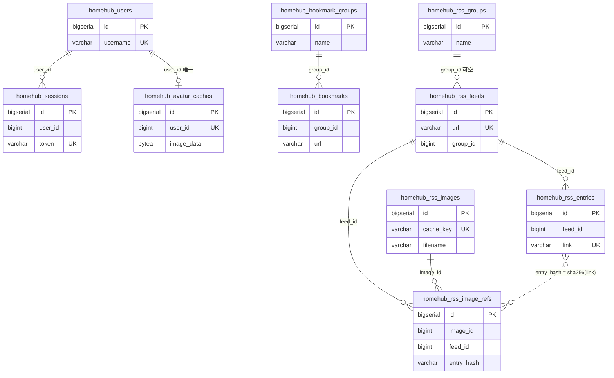

# 数据库表结构

HomeHub 的全部持久化表。用于人工复核与 schema 评审。

**权威性**：表结构由 `internal/app/app.go` 的 `AutoMigrate` 生成（`homehub_pastes`
例外，见下）。本文档中的列类型由 GORM 的 PostgreSQL dialector 解析得出，
与 AutoMigrate 实际执行一致；但**唯一事实源仍是 Go 模型**
（`internal/model/*.go`）。模型变更后请同步本文档。

- 数据库：PostgreSQL
- 表名前缀：`homehub_`（`internal/database/ddl_guard_test.go` 强制）
- 迁移方式：启动时 AutoMigrate（只增列/增索引，不做破坏性变更）

---

## 1. 共同约定

### 1.1 BaseModel

除 `homehub_pastes` 外，所有表都嵌入 `model.BaseModel`，固定含 4 列：

| 列 | 类型 | 说明 |
|----|------|------|
| `id` | `bigserial` | 自增主键 |
| `created_at` | `timestamptz` | 插入时间，GORM 自动维护 |
| `updated_at` | `timestamptz` | 更新时间，GORM 自动维护 |
| `deleted_at` | `timestamptz` | 软删除标记，NULL 表示未删除；带索引 |

`deleted_at` 由 `gorm.DeletedAt` 驱动：GORM 的 `Delete` 写时间戳，普通查询
自动加 `deleted_at IS NULL`，只有 `Unscoped()` 才物理删除。

### 1.2 软删除并非全表一致（重点）

拿到 `deleted_at` 不等于这张表就是软删除。当前实际行为：

| 表 | 删除语义 | 备注 |
|----|---------|------|
| `homehub_sessions` | 软（过期清理未用 `Unscoped`） | 过期行只打标记，不回收 |
| `homehub_rss_entries` | **物理** | retention 与删源都用 `Unscoped()` |
| `homehub_rss_image_refs` | **物理** | 同上；软删除会让联合唯一索引无法复用 |
| `homehub_rss_images` | **物理** | 回收孤儿时用 `Unscoped()`；否则 `cache_key` 唯一键冲突 |
| `homehub_rss_feeds` | **物理** | 删源用 `Unscoped()` |
| `homehub_pastes` | **物理** | 过期清理用 `Unscoped()` |
| `homehub_avatar_caches` | **物理** | 换头像时 `Unscoped()` 删旧行 |
| `homehub_bookmarks` / `homehub_bookmark_groups` | 软 | 分组删除时先软删书签 |
| `homehub_rss_groups` | 软 | 删分组只把 feed 的 `group_id` 置 NULL |
| `homehub_todos` | 软 | |
| `homehub_media_assets` | 软 | 物理文件另行删除 |
| `homehub_users` | 软 | |
| `homehub_log_entries` | 软 | 当前没有删除路径，只增不减 |

**评审要点**：软删除会占住唯一索引。任何带 `uniqueIndex` 的表如果要复用键值，
必须物理删除，否则重新插入会撞索引且被 GORM 的 `ON CONFLICT` 静默吞掉。

### 1.3 没有数据库外键

全库**不声明 FOREIGN KEY 约束**，关联只靠列值 + 应用层维护。
`RSSGroup.Feeds` / `BookmarkGroup.Bookmarks` 上的 `foreignKey:` 只是 GORM
的 `Preload` 提示，不生成约束。

排序规则使用数据库默认（通常 `en_US.UTF-8`），未显式指定 `COLLATE`。

---

## 2. 关系总图



`homehub_rss_entries` 与 `homehub_rss_image_refs` 之间是**逻辑关联**
（`entry_hash` = `sha256(entry.link)`），刻意不做物理外键：条目 link 最长
2048 字符，直接进联合唯一索引会超出 B-tree 索引行上限。

图中未画的三张表与其他表没有关联：`homehub_todos`（全体共享）、
`homehub_log_entries`（只写日志）、`homehub_media_assets`（只被
`webui` 配置里的 asset id 引用，配置存在 JSON 文件而非数据库）、
`homehub_pastes`（完全独立）。

---

## 3. 认证与用户

### 3.1 `homehub_users`

| 列 | 类型 | 约束 | 说明 |
|----|------|------|------|
| `id` | `bigserial` | PK | |
| `created_at` / `updated_at` / `deleted_at` | `timestamptz` | `deleted_at` 有索引 | |
| `username` | `varchar(100)` | NOT NULL, **UNIQUE** | 登录名 |
| `password_hash` | `varchar(255)` | NOT NULL | bcrypt |
| `email` | `varchar(255)` | DEFAULT `''` | 用于 Gravatar |
| `role` | `varchar(20)` | NOT NULL, DEFAULT `'user'` | `admin` / `user` |
| `is_active` | `boolean` | DEFAULT `true` | 停用后不能登录 |

索引：`idx_homehub_users_username`（unique）、`idx_homehub_users_deleted_at`。

**评审要点**：`username` 唯一索引不含 `deleted_at` 条件，因此删掉的用户名
无法复用（软删除行仍占位）。`email` 没有唯一约束，允许多人同邮箱。

### 3.2 `homehub_sessions`

| 列 | 类型 | 约束 | 说明 |
|----|------|------|------|
| `id` | `bigserial` | PK | |
| 公共列 | | | |
| `user_id` | `bigint` | NOT NULL | 指向 `homehub_users.id`，无外键 |
| `token` | `varchar(255)` | NOT NULL, **UNIQUE** | 会话令牌 |
| `expires_at` | `timestamptz` | NOT NULL | 过期时间 |

索引：`idx_homehub_sessions_token`（unique）、`idx_homehub_sessions_user_id`、
`idx_homehub_sessions_deleted_at`。

过期记录由 `service.CleanupExpiredSessions` 每小时清理。

### 3.3 `homehub_avatar_caches`

| 列 | 类型 | 约束 | 说明 |
|----|------|------|------|
| `id` | `bigserial` | PK | |
| 公共列 | | | |
| `user_id` | `bigint` | NOT NULL, **UNIQUE** | 每个用户一份缓存 |
| `variant` | `varchar(160)` | NOT NULL | `来源\|尺寸\|风格\|分级` 指纹 |
| `email_hash` | `varchar(64)` | NOT NULL | 邮箱 MD5，变更后触发重取 |
| `image_data` | `bytea` | NOT NULL | 头像二进制 |
| `content_type` | `varchar(50)` | NOT NULL | 已校验的 MIME |
| `e_tag` | `varchar(255)` | | 上游 ETag（注意列名是 `e_tag`，GORM 拆分缩写） |
| `last_modified` | `varchar(100)` | | 上游 Last-Modified |

索引：`idx_homehub_avatar_caches_user_id`（unique）。

**评审要点**：头像二进制直接入库。1024px JPEG 约 100–300KB，用户量大时
`homehub_avatar_caches` 会成为最大的表；`user_id` 唯一索引保证每人一份。

---

## 4. 书签

### 4.1 `homehub_bookmark_groups`

| 列 | 类型 | 约束 | 说明 |
|----|------|------|------|
| `id` | `bigserial` | PK | |
| 公共列 | | | |
| `name` | `varchar(100)` | NOT NULL | 分组名 |
| `sort_order` | `bigint` | DEFAULT `0` | 上移/下移排序 |
| `priority` | `bigint` | DEFAULT `0` | 首页展示优先级 |

索引：仅 `idx_homehub_bookmark_groups_deleted_at`。

### 4.2 `homehub_bookmarks`

| 列 | 类型 | 约束 | 说明 |
|----|------|------|------|
| `id` | `bigserial` | PK | |
| 公共列 | | | |
| `group_id` | `bigint` | NOT NULL | 指向分组，无外键 |
| `title` | `varchar(255)` | NOT NULL | |
| `url` | `varchar(2048)` | NOT NULL | |
| `icon` | `varchar(2048)` | | 可为空串表示显式清空 |
| `sort_order` | `bigint` | DEFAULT `0` | |
| `priority` | `bigint` | DEFAULT `0` | |

索引：`idx_homehub_bookmarks_group_id`、`idx_homehub_bookmarks_deleted_at`，
外加 `database.EnsureSearchIndexes` 创建的两个 pg_trgm GIN 索引：
`idx_bookmarks_title_trgm(title)`、`idx_bookmarks_url_trgm(url)`。

**评审要点**：`url` 没有唯一约束，同一链接可重复收藏。

---

## 5. 媒体资源

### 5.1 `homehub_media_assets`

| 列 | 类型 | 约束 | 说明 |
|----|------|------|------|
| `id` | `bigserial` | PK | |
| 公共列 | | | |
| `filename` | `varchar(255)` | NOT NULL | 磁盘文件名（UUID） |
| `original_name` | `varchar(255)` | NOT NULL | 上传时的原名 |
| `file_path` | `varchar(512)` | NOT NULL | 相对路径，如 `uploads/xxx.jpg` |
| `file_size` | `bigint` | NOT NULL | 字节 |
| `mime_type` | `varchar(100)` | NOT NULL | 嗅探后确认的类型 |
| `media_type` | `varchar(20)` | NOT NULL | `image` / `video` / `audio` / `document` |
| `width` / `height` | `bigint` | DEFAULT `0` | 仅 jpeg/png/gif 有值 |

索引：`idx_homehub_media_assets_media_type`、`idx_homehub_media_assets_deleted_at`。

**评审要点**：`filename` 没有唯一约束；物理文件在 `web/static/uploads/`，
删记录不保证删文件。`media_type` 的取值由 `media_types.go` 的
`supportedFormats` 驱动，但列本身没有 CHECK 约束。

---

## 6. 日志

### 6.1 `homehub_log_entries`

| 列 | 类型 | 约束 | 说明 |
|----|------|------|------|
| `id` | `bigserial` | PK | |
| 公共列 | | | |
| `level` | `varchar(10)` | NOT NULL | DEBUG/INFO/WARN/ERROR |
| `message` | `varchar(2048)` | NOT NULL | 超长会被截断 |
| `source` | `varchar(255)` | | 调用源文件 |
| `fields` | `text` | | 附加字段，JSON 字符串 |
| `log_time` | `timestamptz` | NOT NULL | 事件时间（与 `created_at` 不同） |

索引：`idx_homehub_log_entries_level`、`idx_homehub_log_entries_log_time`、
`idx_homehub_log_entries_deleted_at`。

**评审要点**：没有任何自动清理。`log.db_writer=true` 时日志会无限增长，
是长期运行后最可能失控的表。建议加按 `log_time` 的保留天数和定期物理删除。

---

## 7. RSS 订阅

### 7.1 `homehub_rss_groups`

| 列 | 类型 | 约束 | 说明 |
|----|------|------|------|
| `id` | `bigserial` | PK | |
| 公共列 | | | |
| `name` | `varchar(100)` | NOT NULL | |
| `sort_order` | `bigint` | DEFAULT `0` | |

### 7.2 `homehub_rss_feeds`

| 列 | 类型 | 约束 | 说明 |
|----|------|------|------|
| `id` | `bigserial` | PK | |
| 公共列 | | | |
| `title` | `varchar(255)` | NOT NULL | 抓取时自动更新 |
| `url` | `varchar(2048)` | NOT NULL, **UNIQUE** | feed 地址 |
| `site_url` | `varchar(2048)` | | 站点主页 |
| `description` | `text` | | |
| `icon_url` | `varchar(2048)` | | 站点图标 |
| `fetch_interval` | `bigint` | DEFAULT `3600` | 秒 |
| `last_fetch` | `timestamptz` | | 最近抓取时间 |
| `error_msg` | `varchar(1024)` | | 最近一次错误，超长截断 |
| `group_id` | `bigint` | NULL 表示未分组 | |

索引：`idx_homehub_rss_feeds_url`（unique）、`idx_homehub_rss_feeds_group_id`、
`idx_homehub_rss_feeds_deleted_at`。

### 7.3 `homehub_rss_entries`

| 列 | 类型 | 约束 | 说明 |
|----|------|------|------|
| `id` | `bigserial` | PK | |
| 公共列 | | | |
| `feed_id` | `bigint` | NOT NULL | 所属源（**当前设计的问题所在，见 §9**） |
| `title` | `varchar(500)` | NOT NULL | |
| `link` | `varchar(2048)` | NOT NULL, **UNIQUE（全表）** | 条目链接 |
| `author` | `varchar(255)` | | |
| `content` | `text` | | 清洗后的 HTML |
| `magnet_url` | `text` | | 从附件/正文提取 |
| `published` | `timestamptz` | | 源给出的时间 |
| `fetched_at` | `timestamptz` | NOT NULL | 本地抓取时间 |

索引：`idx_homehub_rss_entries_link`（**unique，全表**）、
`idx_homehub_rss_entries_feed_id`、`idx_homehub_rss_entries_published`、
`idx_homehub_rss_entries_deleted_at`，以及 pg_trgm 索引
`idx_rss_entries_title_trgm(title)`。

**评审要点**：`link` 的唯一约束是全表级，不是 `(feed_id, link)`。这就是
"A 源抓过、B 源同链接条目消失"的根因。详见 §9。

### 7.4 `homehub_rss_images`

| 列 | 类型 | 约束 | 说明 |
|----|------|------|------|
| `id` | `bigserial` | PK | |
| 公共列 | | | |
| `cache_key` | `varchar(64)` | NOT NULL, **UNIQUE** | `md5(源 URL)` 十六进制 |
| `source_url` | `text` | NOT NULL | 原始图片 URL（回填的历史记录为空串） |
| `filename` | `varchar(255)` | NOT NULL | 缓存目录内文件名 |
| `content_type` | `varchar(100)` | | |
| `size_bytes` | `bigint` | NOT NULL, DEFAULT `0` | |
| `sha256` | `varchar(64)` | | 历史文件为空 |
| `last_seen_at` | `timestamptz` | NOT NULL | 最近被引用的时间，清理依据 |

索引：`idx_homehub_rss_images_cache_key`（unique）、
`idx_homehub_rss_images_last_seen_at`、`idx_homehub_rss_images_deleted_at`。

**评审要点**：`filename` 没有唯一约束，但 `cache_key` 唯一，而文件名由
`cache_key` 唯一决定，实际不会重复。物理文件在
`web/static/uploads/rss_img/`，与 `homehub_media_assets` 共目录但不共表。

### 7.5 `homehub_rss_image_refs`

| 列 | 类型 | 约束 | 说明 |
|----|------|------|------|
| `id` | `bigserial` | PK | |
| 公共列 | | | |
| `image_id` | `bigint` | NOT NULL | 指向 `homehub_rss_images.id` |
| `feed_id` | `bigint` | NOT NULL | 指向 `homehub_rss_feeds.id` |
| `entry_hash` | `varchar(64)` | NOT NULL | `sha256(条目 link)` |

索引：`idx_rss_image_ref`（**unique**，`image_id, feed_id, entry_hash` 三列联合）、
`idx_homehub_rss_image_refs_feed_id`、`idx_homehub_rss_image_refs_deleted_at`。

**评审要点**：

- 用 `entry_hash` 而不是 `entry_id`：条目 link 最长 2048 字符，三列联合
  唯一索引会超 B-tree 限制（单索引行约 2704 字节上限）。
- 联合索引列序是 `(image_id, feed_id, entry_hash)`，**以 `feed_id` 开头的
  查询用不上它**（B-tree 只能从最左列匹配），实际走
  `idx_homehub_rss_image_refs_feed_id` 单列索引。当前查询模式是
  `WHERE feed_id = ? AND entry_hash IN (...)`，单列索引够用；数据量增长后
  可考虑补 `(feed_id, entry_hash)` 复合索引。
- 这张表只增不减的旧行为已修正：现在 `reconcileRefs` 会定期删除没有对应
  条目的引用。

---

## 8. 待办与剪贴板

### 8.1 `homehub_todos`

| 列 | 类型 | 约束 | 说明 |
|----|------|------|------|
| `id` | `bigserial` | PK | |
| 公共列 | | | |
| `title` | `varchar(500)` | NOT NULL | |
| `description` | `text` | | |
| `status` | `varchar(20)` | NOT NULL, DEFAULT `'pending'` | 见下 |
| `priority` | `bigint` | DEFAULT `0` | 越大越靠前 |
| `due_date` | `timestamptz` | 可空 | |
| `sort_order` | `bigint` | DEFAULT `0` | |

`status` 合法值：`planned` / `pending` / `in_progress` / `completed` / `paused`。
应用层 `model.IsValidTodoStatus` 校验，**数据库没有 CHECK 约束**。

索引：`idx_homehub_todos_status`、`idx_homehub_todos_deleted_at`。

**评审要点**：待办是**全体用户共享**的，表上没有 `user_id`。这是产品决策，
不是遗漏；但多用户场景下无法做到人各有份。

### 8.2 `homehub_pastes`

这张表**不经过 AutoMigrate**，由 `model.CreatePastesTable` 手工建表。
原因是业务层用物理删除，而 AutoMigrate 会按 `BaseModel` 生成一套列定义；
显式 DDL 让 `deleted_at` 的存在理由（与模型对齐）写在建表语句旁边。

```sql
CREATE TABLE IF NOT EXISTS homehub_pastes (
    id BIGSERIAL PRIMARY KEY,
    created_at TIMESTAMPTZ NOT NULL DEFAULT NOW(),
    updated_at TIMESTAMPTZ NOT NULL DEFAULT NOW(),
    deleted_at TIMESTAMPTZ,
    public_id VARCHAR(12) NOT NULL UNIQUE,
    content TEXT NOT NULL,
    delete_token VARCHAR(64) NOT NULL,
    expires_at TIMESTAMPTZ
)
```

| 列 | 说明 |
|----|------|
| `public_id` | 12 字符随机 ID（`model.NanoID`，字母数字），出现在 URL 里，带 UNIQUE（索引名由 PostgreSQL 默认生成为 `homehub_pastes_public_id_key`） |
| `content` | 正文，上限由 `pastebin.max_content_length` 控制（默认 1MB） |
| `delete_token` | 删除凭证，只返回一次 |
| `expires_at` | 过期时间，到期后物理删除 |

**评审要点**：与其它表不同，这里**没有**为 `expires_at` 或 `deleted_at` 建索引，
过期清理是 `WHERE expires_at < now()` 全表扫描。数据量小时无所谓，长期运行
建议加 `CREATE INDEX ON homehub_pastes (expires_at)`。

`delete_token` 没有唯一约束，也没有索引；删除操作走 `public_id` 定位后再比对
token，因此不需要额外索引。

---

## 9. 已识别的问题（供研判）

### 9.1 `homehub_rss_entries.link` 全局唯一

**现状**：`idx_homehub_rss_entries_link` 是单列唯一索引。

**后果**：两个源收录同一链接（转载、聚合站）时，后抓的源命中
`ON CONFLICT (link) DO UPDATE magnet_url`，条目仍归属先抓到的源。
B 源的用户视角里这条内容不存在。

**两个候选修法**：

#### 方案 A：复合唯一 `(feed_id, link)`

```
DROP INDEX idx_homehub_rss_entries_link;
CREATE UNIQUE INDEX idx_homehub_rss_entries_feed_link
    ON homehub_rss_entries (feed_id, link);
```

- 同一链接在 N 个源下存 N 行，各源看到自己的那份
- 改动量：**极小**。所有查询仍是 `WHERE feed_id = ?`，代码几乎不动
- 代价：`content` 重复 N 份（每份最大约 2000 字符 + 清洗后的 HTML），
  跨源去重失效
- 语义：仍然是"一条内容属于一个源"，只是允许多个源各存一份

#### 方案 B：内容表 + 关联表（真正的一条内容指向多个源）

```sql
-- entries 变成纯内容表，按 link 去重
ALTER TABLE homehub_rss_entries DROP COLUMN feed_id;
-- 新建关联表，承载"哪个源收录了它、该源的发布时间"
CREATE TABLE homehub_rss_entry_feeds (
    id           BIGSERIAL PRIMARY KEY,
    created_at   TIMESTAMPTZ NOT NULL DEFAULT NOW(),
    updated_at   TIMESTAMPTZ NOT NULL DEFAULT NOW(),
    deleted_at   TIMESTAMPTZ,
    entry_id     BIGINT NOT NULL,
    feed_id      BIGINT NOT NULL,
    published    TIMESTAMPTZ,
    first_seen_at TIMESTAMPTZ NOT NULL
);
CREATE UNIQUE INDEX idx_rss_entry_feeds_pair
    ON homehub_rss_entry_feeds (entry_id, feed_id);
CREATE INDEX idx_rss_entry_feeds_feed_published
    ON homehub_rss_entry_feeds (feed_id, published DESC);
```

- 一条内容只存一份，被 N 个源指向
- `ListEntries(feed)` 改为 JOIN 关联表；retention 按"关联行"计
- 代价：改动大；`ALTER TABLE ... DROP COLUMN` 是破坏性 DDL，
  需要手工执行（`ddl_guard_test.go` 禁止它出现在启动流程）
- 附带好处：`RSSImageRef` 可以简化为 `(image_id, entry_id)`，
  不再需要 `feed_id` + `entry_hash` 这种绕路设计

**待决**：

1. 选 A 还是 B。若目标是"一条内容被多个源指向"，只有 B 满足；A 只是
   让每个源各存一份副本。
2. B 的 `content` 冲突策略。同一链接两个源可能给出不同正文（一个全文、
   一个摘要）。可选：首次写入优先 / 取更长者 / 按源的可信度排序。
   当前 `ON CONFLICT (link) DO UPDATE magnet_url` 只更新磁力链接，等价于
   "首次写优先"。
3. B 的迁移路径。`ALTER TABLE ... DROP COLUMN` 不可逆，建议分两阶段：
   **阶段 1** 建关联表 + 回填 + 代码双写（`entries.feed_id` 保留但不再读），
   **阶段 2** 稳定运行一段后再删列。这样阶段 1 完全可回滚。
   若走两阶段，阶段 1 只需要 `CREATE TABLE` / `CREATE INDEX` 与一条
   `INSERT ... SELECT`，不需要授权 `DROP COLUMN`。

### 9.2 其他已知项

| 表 | 问题 | 影响 |
|----|------|------|
| `homehub_log_entries` | 无自动清理 | 长期运行后无限增长 |
| `homehub_pastes` | `expires_at` 无索引 | 过期清理全表扫描 |
| `homehub_users` | `username` 唯一索引含软删除行 | 删除后用户名不可复用 |
| `homehub_media_assets` | `filename` 无唯一约束 | 理论上可重复，实际由 UUID 保证 |
| `homehub_todos` | `status` 无 CHECK 约束 | 非法值只能靠应用层拦截 |
| `homehub_rss_entries` | `feed_id` 无外键 | 源被删后可能留下孤儿条目（删源逻辑已处理） |

---

## 10. 迁移脚本（需要手工执行，不在启动流程里）

`ddl_guard_test.go` 把 `DROP TABLE` / `DROP INDEX` / `ALTER TABLE` 全部
判为违规，因此任何破坏性变更都必须由人执行。

### 10.1 方案 A（若采纳）

```sql
BEGIN;

-- 1. 删除全表唯一索引
DROP INDEX IF EXISTS idx_homehub_rss_entries_link;

-- 2. 建复合唯一索引
CREATE UNIQUE INDEX IF NOT EXISTS idx_homehub_rss_entries_feed_link
    ON homehub_rss_entries (feed_id, link);

COMMIT;
```

对应模型改动：把 `RSSEntry.Link` 的 tag 从
`gorm:"uniqueIndex"` 改为 `gorm:"uniqueIndex:idx_rss_entries_feed_link"`，
并给 `FeedID` 加同名 `uniqueIndex`。**必须先手工建索引再改模型**，
否则 AutoMigrate 会先建出新索引、旧索引仍然存在，两个约束同时生效。

### 10.2 方案 B（若采纳）

```sql
BEGIN;

CREATE TABLE IF NOT EXISTS homehub_rss_entry_feeds (
    id BIGSERIAL PRIMARY KEY,
    created_at TIMESTAMPTZ NOT NULL DEFAULT NOW(),
    updated_at TIMESTAMPTZ NOT NULL DEFAULT NOW(),
    deleted_at TIMESTAMPTZ,
    entry_id BIGINT NOT NULL,
    feed_id BIGINT NOT NULL,
    published TIMESTAMPTZ,
    first_seen_at TIMESTAMPTZ NOT NULL
);

-- 把现有归属搬进关联表
INSERT INTO homehub_rss_entry_feeds (entry_id, feed_id, published, first_seen_at, created_at, updated_at)
SELECT id, feed_id, published, fetched_at, created_at, updated_at
FROM homehub_rss_entries
WHERE deleted_at IS NULL;

CREATE UNIQUE INDEX IF NOT EXISTS idx_rss_entry_feeds_pair
    ON homehub_rss_entry_feeds (entry_id, feed_id);
CREATE INDEX IF NOT EXISTS idx_rss_entry_feeds_feed_published
    ON homehub_rss_entry_feeds (feed_id, published DESC);

-- 确认行数一致后再删列（不可逆，先备份）
-- ALTER TABLE homehub_rss_entries DROP COLUMN feed_id;

COMMIT;
```

删列前务必核对：

```sql
SELECT count(*) FROM homehub_rss_entries WHERE deleted_at IS NULL;
SELECT count(DISTINCT entry_id) FROM homehub_rss_entry_feeds;
```
