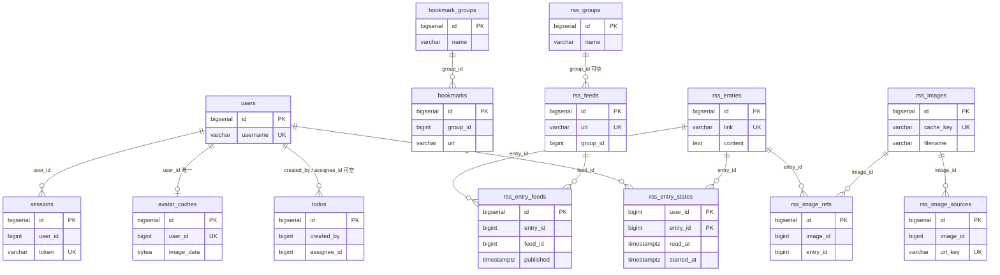

# 数据库表结构

HomeHub 的全部持久化表。用于人工复核与 schema 评审。

**权威性**：表结构由 `AutoMigrate` 生成，模型列表在
`model.AutoMigrateModels()`，启动流程与集成测试共用（`pastes` 例外，见下）。本文档中的列类型由 GORM 的 PostgreSQL dialector 解析得出，
与 AutoMigrate 实际执行一致；但**唯一事实源仍是 Go 模型**
（`internal/model/*.go`）。模型变更后请同步本文档。

- 数据库：PostgreSQL
- 表名：**无统一前缀**（早期带 `homehub_`，已全部去掉）
- 表名白名单：`internal/database/ddl_guard_test.go` 的 `homeHubTables`
- 迁移方式：启动时 AutoMigrate（只增列/增索引，不做破坏性变更）

> **表名隔离机制已变**：去掉前缀后，靠前缀区分“本仓库的表”和“同一个库里
> 其他项目的表”不再可行。现在改用**显式允许列表**：任何 `CREATE TABLE` /
> `CREATE INDEX` 的目标表不在 `homeHubTables` 里，`go test` 就会失败。
> 新增表必须同步登记——这点摩擦是故意的。
>
> 同一个库还放着独立的 B 站爬虫项目（`bilibili_*` / `crawler_state` 等）。
> 那些表名仍在黑名单里，任何引用都会被测试拦下。

---

## 1. 共同约定

### 1.1 BaseModel

除 `pastes` 外，所有表都嵌入 `model.BaseModel`，固定含 4 列：

| 列 | 类型 | 说明 |
|----|------|------|
| `id` | `bigserial` | 自增主键 |
| `created_at` | `timestamptz` | 插入时间，GORM 自动维护 |
| `updated_at` | `timestamptz` | 更新时间，GORM 自动维护 |
| `deleted_at` | `timestamptz` | 软删除标记，NULL 表示未删除；带索引 |

`deleted_at` 由 `gorm.DeletedAt` 驱动：GORM 的 `Delete` 写时间戳，普通查询
自动加 `deleted_at IS NULL`，只有 `Unscoped()` 才物理删除。

### 1.2 软删除并非全表一致（重点）

拿到 `deleted_at` 不等于这张表就是软删除。当前实际行为：

| 表 | 删除语义 | 备注 |
|----|---------|------|
| `sessions` | **物理**（2026-10 修正） | 过期清理用 `Unscoped`，见 §3.2 |
| `rss_entries` | **物理** | 仅当条目成为孤儿（没有源收录）时删除 |
| `rss_image_refs` | **物理** | 随孤儿条目删除 |
| `rss_image_sources` | **物理** | URL → 内容 映射；内容被回收时一并删 |
| `rss_images` | **物理** | 回收孤儿时用 `Unscoped()`；否则 `cache_key` 唯一键冲突 |
| `rss_entry_feeds` | **物理** | 删源 / retention 都删关联行 |
| `rss_entry_states` | **物理**（无 `deleted_at`） | 随孤儿条目删除；删用户时删除；取消已读与星标后两列皆空也删除 |
| `rss_feeds` | **物理** | 删源用 `Unscoped()` |
| `pastes` | **物理** | 过期清理用 `Unscoped()` |
| `avatar_caches` | **物理** | 换头像时 `Unscoped()` 删旧行 |
| `bookmarks` / `bookmark_groups` | 软 | 分组删除时先软删书签 |
| `rss_groups` | 软 | 删分组只把 feed 的 `group_id` 置 NULL |
| `todos` | 软 | |
| `media_assets` | **物理**（2026-10 修正） | 图床资产：文件与记录同时删，软删除无恢复意义 |
| `users` | 软 | |
| `log_entries` | 软 | 当前没有删除路径，只增不减 |

**评审要点**：软删除会占住唯一索引。任何带 `uniqueIndex` 的表如果要复用键值，
必须物理删除，否则重新插入会撞索引且被 GORM 的 `ON CONFLICT` 静默吞掉。

### 1.3 没有数据库外键

全库**不声明 FOREIGN KEY 约束**，关联只靠列值 + 应用层维护。
`RSSGroup.Feeds` / `BookmarkGroup.Bookmarks` 上的 `foreignKey:` 只是 GORM
的 `Preload` 提示，不生成约束。

排序规则使用数据库默认（通常 `en_US.UTF-8`），未显式指定 `COLLATE`。

---

## 2. 关系总图



条目是**跨源共享的内容**：`rss_entries` 只存内容（按 `link` 全表
唯一），"哪个源收录了它"由 `rss_entry_feeds` 表达。一条内容可以
被任意多个源收录，删除其中一个源只删它那一行关联。

图片引用挂在**条目**上：内容被多源共享时图片只有一份引用，删掉任一源
都不会让图片变成孤儿。

图中未画的表与其他表没有关联：`log_entries`（只写日志）、`media_assets`（只被
`webui` 配置里的 asset id 引用，配置存在 JSON 文件而非数据库）、
`pastes`（完全独立）。

---

## 3. 认证与用户

### 3.1 `users`

| 列 | 类型 | 约束 | 说明 |
|----|------|------|------|
| `id` | `bigserial` | PK | |
| `created_at` / `updated_at` / `deleted_at` | `timestamptz` | `deleted_at` 有索引 | |
| `username` | `varchar(100)` | NOT NULL, **UNIQUE** | 登录名 |
| `password_hash` | `varchar(255)` | NOT NULL | bcrypt |
| `email` | `varchar(255)` | DEFAULT `''` | 用于 Gravatar |
| `level` | `integer` | NOT NULL, DEFAULT `5`，有索引 | 权限等级 1–5，**1 最高** |
| `is_active` | `boolean` | DEFAULT `true` | 停用后不能登录 |

索引：`idx_users_username`（unique）、`idx_users_level`、`idx_users_deleted_at`。

**`level` 是权限的唯一事实源。** 早期这一列叫 `role`（`varchar`，取值
`admin`/`user`）。改成整数等级后有三个好处：等级天然可比，判断就是一次
`user.Level <= required`；新增权限点只需指定门槛，不必维护“允许角色列表”；
不可能出现“role 说 admin、level 说 5”这种矛盾。

`role` 字符串仍在 API 输出里，但它**不是列** —— 由 `level` 在
`MarshalJSON` 里派生，只为兼容既有前端。数据库里已经不存它。

等级定义见 `internal/model/permission.go`：

| 值 | 名称 | 能力 |
|----|------|------|
| 1 | admin | 配置、用户、日志、全部内容 |
| 2 | operator | 用户管理（不含 1 级）、日志 |
| 3 | editor | 全部内容，不分作者 |
| 4 | member | 只能改自己创建的内容 |
| 5 | viewer | 只读 |

**评审要点**：

- `username` 唯一索引不含 `deleted_at` 条件，因此删掉的用户名无法复用
  （软删除行仍占位）。`email` 没有唯一约束，允许多人同邮箱。
- `level` 的默认值是 **5（最低）**。任何漏设等级的路径都不会意外造出
  高权限账号 —— 失败方向必须是降权。
- 非法等级（0、负数、>5）在 `HasLevel` 里一律拒绝。少了这一步就是
  fail-open：`0 <= 1` 会让没初始化的账号拿到最高权限。

### 3.2 `sessions`

| 列 | 类型 | 约束 | 说明 |
|----|------|------|------|
| `id` | `bigserial` | PK | |
| 公共列 | | | |
| `user_id` | `bigint` | NOT NULL | 指向 `users.id`，无外键 |
| `token` | `varchar(255)` | NOT NULL, **UNIQUE** | 会话令牌 |
| `expires_at` | `timestamptz` | NOT NULL | 过期时间 |

索引：`idx_sessions_token`（unique）、`idx_sessions_user_id`、
`idx_sessions_expires_at`、`idx_sessions_deleted_at`。

过期记录由 `service.CleanupExpiredSessions` 每小时清理，**物理删除**
（`Unscoped`）。`expires_at` 上的索引是为此清理查询而建——没有它时
每次清理都是全表扫描，而表越大扫描越慢。

### 3.3 `avatar_caches`

| 列 | 类型 | 约束 | 说明 |
|----|------|------|------|
| `id` | `bigserial` | PK | |
| 公共列 | | | |
| `user_id` | `bigint` | NOT NULL, **UNIQUE** | 每个用户一份缓存 |
| `variant` | `varchar(160)` | NOT NULL | `来源\|尺寸\|风格\|分级` 指纹 |
| `email_hash` | `varchar(64)` | NOT NULL | 邮箱 MD5，变更后触发重取 |
| `image_data` | `bytea` | NOT NULL | 头像二进制 |
| `content_type` | `varchar(50)` | NOT NULL | 已校验的 MIME |
| `e_tag` | `varchar(255)` | | 上游 ETag（注意列名是 `e_tag`，GORM 拆分缩写） |
| `last_modified` | `varchar(100)` | | 上游 Last-Modified |

索引：`idx_avatar_caches_user_id`（unique）。

**评审要点**：头像二进制直接入库。1024px JPEG 约 100–300KB，用户量大时
`avatar_caches` 会成为最大的表；`user_id` 唯一索引保证每人一份。

对外响应的 `ETag` 由 `(variant, email_hash, 图片内容的 SHA-256)` 共同派生。
早期只用前两者，导致上游换了头像、而配置与邮箱都没变时 ETag 不变，浏览器
带 `If-None-Match` 重验永远拿到 304 —— "刷新头像"看起来成功了，页面却
一直显示旧图。注意这个 `ETag` 是**对外**的，与表里的 `e_tag` 列（上游
响应的 ETag，用于向外发条件请求）不是同一个东西。

---

## 4. 书签

### 4.1 `bookmark_groups`

| 列 | 类型 | 约束 | 说明 |
|----|------|------|------|
| `id` | `bigserial` | PK | |
| 公共列 | | | |
| `name` | `varchar(100)` | NOT NULL | 分组名 |
| `sort_order` | `bigint` | DEFAULT `0` | 上移/下移排序 |
| `priority` | `bigint` | DEFAULT `0` | 首页展示优先级 |

索引：仅 `idx_bookmark_groups_deleted_at`。

### 4.2 `bookmarks`

| 列 | 类型 | 约束 | 说明 |
|----|------|------|------|
| `id` | `bigserial` | PK | |
| 公共列 | | | |
| `group_id` | `bigint` | NOT NULL | 指向分组，无外键 |
| `title` | `varchar(255)` | NOT NULL | |
| `url` | `varchar(2048)` | NOT NULL | |
| `icon` | `varchar(2048)` | | 可为空串表示显式清空 |
| `sort_order` | `bigint` | DEFAULT `0` | |
| `priority` | `bigint` | DEFAULT `0` | |

索引：`idx_bookmarks_group_id`、`idx_bookmarks_deleted_at`，
外加 `database.EnsureSearchIndexes` 创建的两个 pg_trgm GIN 索引：
`idx_bookmarks_title_trgm(title)`、`idx_bookmarks_url_trgm(url)`。

**评审要点**：`url` 没有唯一约束，同一链接可重复收藏。

---

## 5. 媒体资源（图床）

这一张表只存**用户上传**的资产，是图床的主体。RSS 抓取的图片不在
这张表里，见 §7.5—— 两者的生命周期根本不同：用户上传的资产是长期
持有的内容，RSS 图片是可回收的抓取缓存（按内容去重、引用计数、
按 `last_seen_at` 自动清理）。混在一张表里会让清理逻辑无法区分
“能不能删”。

物理文件在 `web/static/uploads/`，通过 `/static/uploads/<filename>`
公开读取（`server.go` 的 `r.Static`）。图床需要外部能直接引用，
所以这条路径**不走认证**——要保护的文件不该放进这个目录。

### 5.1 `media_assets`

| 列 | 类型 | 约束 | 说明 |
|----|------|------|------|
| `id` | `bigserial` | PK | |
| 公共列 | | | |
| `filename` | `varchar(255)` | NOT NULL | 磁盘文件名（UUID + 扩展名） |
| `original_name` | `varchar(255)` | NOT NULL | 上传时的原名（超长按字符截断） |
| `file_path` | `varchar(512)` | NOT NULL | 相对路径，如 `uploads/xxx.jpg` |
| `file_size` | `bigint` | NOT NULL | 字节 |
| `sha256` | `varchar(64)` | 有索引 | 内容哈希，用于完整性校验与将来去重 |
| `mime_type` | `varchar(100)` | NOT NULL | 嗅探后确认的类型 |
| `media_type` | `varchar(20)` | NOT NULL | `image` / `video` / `audio` / `document` |
| `source` | `varchar(20)` | NOT NULL, DEFAULT `'upload'`，有索引 | 来源：`upload`（用户上传）/ `rss`（预留） |
| `owner_id` | `bigint` | NOT NULL, DEFAULT `0`，有索引 | 上传者 ID；`0` 表示历史数据无归属 |
| `width` / `height` | `bigint` | DEFAULT `0` | 仅 jpeg/png/gif 有值 |

索引：`idx_media_assets_media_type`、`idx_media_assets_sha256`、
`idx_media_assets_source`、`idx_media_assets_owner_id`、
`idx_media_assets_deleted_at`。

**`owner_id` 解决的是一个真实存在的水平越权**：改造前任何登录用户都能
删除任意媒体资源，包括别人正在当背景用的图。图床的语义是“我传的图归我管”，
所以删除时会校验归属：

- 1–3 级：可以删任意（editor 按设计管全部内容）；
- 4 级（member）：只能删 `owner_id == 自己` 的；
- 5 级（viewer）：只读，不能删；
- `owner_id = 0`（历史数据）：只有 1–3 级能动，member 删不了。

**评审要点**：

- 删除是**物理删除**（`Unscoped`），顺序是先删记录再删文件。
  对一个文件已删的图床资产，软删除提供不了任何恢复能力，
  只会让记录与磁盘长期不一致。
- `source` 目前恒为 `upload`。RSS 图片走自己的表，不会写进来；
  这个字段是为将来“统一图床视图”预留的，不是现在的路由依据。
- `sha256` 已记录但**未做自动去重**：同一张图重复上传仍会存两份。
  真正的去重需要引用计数（否则删一份会误伤另一份），属于后续工作。
- `media_type` 的取值由 `media_types.go` 的 `supportedFormats` 驱动，
  但列本身没有 CHECK 约束。

---

## 6. 日志

### 6.1 `log_entries`

| 列 | 类型 | 约束 | 说明 |
|----|------|------|------|
| `id` | `bigserial` | PK | |
| 公共列 | | | |
| `level` | `varchar(10)` | NOT NULL | DEBUG/INFO/WARN/ERROR |
| `message` | `varchar(2048)` | NOT NULL | 超长会被截断 |
| `source` | `varchar(255)` | | 调用源文件 |
| `fields` | `text` | | 附加字段，JSON 字符串 |
| `log_time` | `timestamptz` | NOT NULL | 事件时间（与 `created_at` 不同） |

索引：`idx_log_entries_level`、`idx_log_entries_log_time`、
`idx_log_entries_deleted_at`。

**保留期**：`log.retention_days`（默认 30，0 = 不限，范围 0–3650）。
启动时与之后每 6 小时按 `log_time` 物理删除过期行
（`DELETE FROM log_entries WHERE log_time < $1`），每轮读取最新配置。

`message` 入库前会按字符截断到 2048 并补 "..."（`model.TruncateEllipsis`）。
这层保护是必须的：日志消息会包含抓取错误、上游响应片段等不受控内容，
一旦超出 `varchar(2048)`，PostgreSQL 会拒收**整批** INSERT（写入是按 100 条
批量提交的），一条超长日志会连带丢掉 99 条正常日志。截断按 rune 进行，
不会把中文切成半个字符。

---

## 7. RSS 订阅

### 7.1 `rss_groups`

| 列 | 类型 | 约束 | 说明 |
|----|------|------|------|
| `id` | `bigserial` | PK | |
| 公共列 | | | |
| `name` | `varchar(100)` | NOT NULL | |
| `sort_order` | `bigint` | DEFAULT `0` | |

### 7.2 `rss_feeds`

| 列 | 类型 | 约束 | 说明 |
|----|------|------|------|
| `id` | `bigserial` | PK | |
| 公共列 | | | |
| `title` | `varchar(255)` | NOT NULL | 抓取时自动更新 |
| `url` | `varchar(2048)` | NOT NULL, **UNIQUE** | feed 地址 |
| `site_url` | `varchar(2048)` | | 站点主页 |
| `description` | `text` | | |
| `icon_url` | `varchar(2048)` | | 站点图标 |
| `fetch_interval` | `bigint` | DEFAULT `3600` | 秒 |
| `last_fetch` | `timestamptz` | | 最近抓取时间 |
| `error_msg` | `varchar(1024)` | | 最近一次错误，超长截断 |
| `group_id` | `bigint` | NULL 表示未分组 | |

索引：`idx_rss_feeds_url`（unique）、`idx_rss_feeds_group_id`、
`idx_rss_feeds_deleted_at`。

### 7.3 `rss_entries`

| 列 | 类型 | 约束 | 说明 |
|----|------|------|------|
| `id` | `bigserial` | PK | |
| 公共列 | | | |
| `title` | `varchar(500)` | NOT NULL | |
| `link` | `varchar(2048)` | NOT NULL, **UNIQUE（全表）** | 条目链接 |
| `author` | `varchar(255)` | | |
| `content` | `text` | | 清洗后的 HTML |
| `magnet_url` | `text` | | 从附件/正文提取 |
| `published` | `timestamptz` | | 源给出的时间 |
| `fetched_at` | `timestamptz` | NOT NULL | 本地抓取时间 |
| `magnet_locked` | `boolean` | NOT NULL, DEFAULT `false`，有索引 | 磁力链接已锁定 |
| `magnet_locked_at` | `timestamptz` | | 锁定时间 |
| `magnet_locked_by` | `bigint` | NOT NULL, DEFAULT `0` | 锁定者；`0` = 系统自动锁定 |
| `pikpak_status` | `varchar(20)` | NOT NULL, DEFAULT `''`，有索引 | 空 / pending / saved / failed |
| `pikpak_task_id` | `varchar(128)` | | PikPak 任务 ID |
| `pikpak_error` | `varchar(512)` | | 最近一次提交失败原因（已截断） |
| `pikpak_saved_at` | `timestamptz` | | 提交成功时间 |

索引：`idx_rss_entries_link`（**unique，全表**）、
`idx_rss_entries_feed_id`、`idx_rss_entries_published`、
`idx_rss_entries_magnet_locked`、`idx_rss_entries_pikpak_status`、
`idx_rss_entries_deleted_at`，以及 pg_trgm 索引
`idx_rss_entries_title_trgm(title)`、`idx_rss_entries_content_trgm(content)`、
`idx_rss_entries_author_trgm(author)`。全局搜索匹配这三列；没有单独的摘要列
（摘要在列表查询时从 `content` 现算），所以正文索引只能建在 `content` 上。
GIN trgm 存的是三元组，没有 btree 的单键字节上限，长正文也建得出来。

**磁力锁定与 PikPak 是两个独立维度**：

- **锁定**保护 `magnet_url` 不被后续抓取改写。抓取时的 upsert 有三层
  保护：`magnet_locked = TRUE` 时一个字都不改；否则新值为空时保留旧值；
  都不满足才采用新值。少了第一层，源站换了磁力链接就会覆盖人工确认过的值。
- **PikPak 提交**是外部副作用（往第三方账号里塞下载任务），要求先锁定。
  这不是多余的门槛：对一条随时可能被改写的链接做提交，等于把“我确认过”
  这件事交给了一个不确定的输入。

`magnet_locked_by = 0` 表示自动锁定（`rss.pikpak.auto_lock` 开启时抓取
自动标记），与人工锁定（记录真实用户 ID）区分开。

> **列名注意**：这四列显式写了 `gorm:"column:pikpak_*"`。不写的话 GORM
> 会把 `PikPak` 拆成 `pik_pak`，得到 `pik_pak_status` 这种与 JSON、
> 文档、手写 SQL 都不一致的名字。

**评审要点**：`link` 全局唯一是**刻意的**。条目是纯内容、跨源共享；
归属不在这张表上，而在 `rss_entry_feeds`。同一篇文章被 N 个源
收录时只有一行内容，`content` 不重复存储。

`feed_id` 列在旧版本中存在，改造后不再写入；列保留（nullable）以便回滚，
可以用 `DROP COLUMN` 清掉，见 §10。

### 7.4 `rss_entry_feeds`

条目与订阅源的收录关系，条目归属的**唯一事实源**。

| 列 | 类型 | 约束 | 说明 |
|----|------|------|------|
| `id` | `bigserial` | PK | |
| 公共列 | | | |
| `entry_id` | `bigint` | NOT NULL | 指向 `rss_entries.id` |
| `feed_id` | `bigint` | NOT NULL | 指向 `rss_feeds.id` |
| `published` | `timestamptz` | | **该源**给出的发布时间 |
| `first_seen_at` | `timestamptz` | NOT NULL | 首次被该源收录 |
| `last_seen_at` | `timestamptz` | NOT NULL | 最近一次出现在该源 |

索引：`idx_rss_entry_feed`（**unique**，`entry_id, feed_id`）、
`idx_rss_entry_feeds_feed_id`、`idx_rss_entry_feeds_published`、
`idx_rss_entry_feeds_deleted_at`。

**评审要点**：

- `retention_count` 的计数单位是这张表的行数，不是条目表。每个源各自
  保留自己的收录份额。
- `published` 放在这里而不是条目上：同一篇文章在两个源可能给出不同时间。
- 删除条目时先删关联、再判定孤儿。孤儿判定必须查"当前是否还有关联行"，
  不能用删除前的候选集。

### 7.5 `rss_images`

一张**内容**一行，不是一张 URL 一行。这是整套去重的基础。

| 列 | 类型 | 约束 | 说明 |
|----|------|------|------|
| `id` | `bigserial` | PK | |
| 公共列 | | | |
| `cache_key` | `varchar(64)` | NOT NULL, **UNIQUE** | 内容 SHA256 十六进制 |
| `source_url` | `text` | NOT NULL | 首次见到该内容时的 URL |
| `filename` | `varchar(255)` | NOT NULL | `rss_<时间戳>_<随机>_<内容哈希前8>.<ext>` |
| `content_type` | `varchar(100)` | | |
| `size_bytes` | `bigint` | NOT NULL, DEFAULT `0` | |
| `last_seen_at` | `timestamptz` | NOT NULL | 最近被引用的时间，清理依据 |

索引：`idx_rss_images_cache_key`（unique）、
`idx_rss_images_last_seen_at`、`idx_rss_images_deleted_at`。

**设计要点**：

- **身份是内容，不是 URL**。同一张图即使以不同 URL 出现（CDN 签名参数、
  转载站换域名、时效 token 每轮都变）也只存一份文件。早期用
  `md5(源 URL)` 做键，这三种情况都会重复存储。
- **没有单独的 `sha256` 列**。`cache_key` 本身就是内容 SHA-256，再加一列
  同值字段会让每条记录维护两棵 B-tree（写入放大、索引体积翻倍），
  却提供不了任何额外查询能力。
- **文件名与身份分开**。`rss_<时间戳>_<随机>_<哈希前8>` 里，时间与随机
  负责“不可枚举、不随时间重复”，哈希后级负责“排障时能反查是谁”。
  唯一性由 `cache_key` 保证，不依赖文件名。
- 物理文件在 `web/static/uploads/rss_img/`，与 `media_assets`
  共用 `uploads/` 父目录但不同子目录、不同表、不同生命周期。
- 旧数据（`md5(URL)` 作键、文件名 `rss_<md5>.<ext>`）仍能识别并认领：
  `resolve` 会先按旧命名找文件，命中就补建映射，不会重下。

**写入路径的三个必须知道的行为**：

1. **同批去重**。一批 URL 里多个不同 URL 完全可能解析到同一内容
   （CDN 签名、http/https 双写、转载站）。`register` 把这批结果作为
   **一条多行** `INSERT ... ON CONFLICT DO UPDATE` 的输入，而
   PostgreSQL 不允许同一语句内两行命中同一个冲突键
   （`21000`），后果是**整批登记失败**。因此登记前必须按 `cacheKey`
   去重、按 `urlKey` 去重。

   去重后返回 `cacheKey → 已登记文件名` 的映射，调用方必须用这个
   映射输出 URL，不能用自己的 `filename`：被去重丢弃的那条、以及
   被归一化成旧名的那些，用自己的名字就会指向没有记录的文件。
2. **filename 按磁盘实情改写**。冲突时不是简单不更新：若旧记录指向的
   文件已丢失（磁盘被清、迁移漏拷），必须改成本次新落盘的名字，
   否则永久死链（下次查到旧名 → stat 失败 → 重下载 → 又写不进去）。
   判定依据只能是 `os.Stat`。
3. **登记失败不写正文，留给下次重试**。图片行、URL 映射、条目引用在
   一个事务里写入，任一失败则整体回滚，`Cache()` 把该失败作为 `error`
   返回，`sanitizeContent` 收到后返回空串，让条目正文保持为空。
   正文一旦落库就不重算，写进去等于把这批图片永久丢掉；空正文下次
   抓取会重新处理——这是唯一的自愈路径。

   “某张图下载不到”不走这条路：那是常态，只体现在映射里缺少 key，
   正文照常落库（图片标签被移除）。

   `Adopt` 同理：它返回的每个 URL 都指向 `register` 实际登记的文件名。
   同批两个 item 内容相同时（extension 各自落了一份文件），两条 URL
   会指向同一个文件，而不会一条指向被去重丢弃的那个。

**清理时的保护**：`Sweep` 用两重机制避免误删正在处理的文件——
`pending` 引用计数（下载完成到登记完成之间的窗口）、以及至少 1 分钟的
宽限期（`grace=0` 也保留）。引用计数而非集合，是因为两个并发批次
可能解析到**同一个内容键**，用集合会让先完成者摘掉后完成者的保护。

**并发去重**：`contentMu` 串行化“算完内容哈希 → 决定落盘还是复用”
这一步。不加锁时并发下载同一内容（不同 URL、相同字节）会全部在
`lookupByContent` 里 miss（前一个的登记要等整批 `register`），
各自落一份文件。锁内只有 rename 与内存记录，数据已写入临时文件，
耗时很短。进程内的 `memContent`（内容哈希 → 结果）是这条路径的
复用入口，无数据库时它是唯一手段。

### 7.6 `rss_image_sources`

URL → 内容 的映射。没有它，每轮抓取都得重新下载才能算出内容哈希，
去重就变成了“省磁盘赔带宽”。

| 列 | 类型 | 约束 | 说明 |
|----|------|------|------|
| `id` | `bigserial` | PK | |
| 公共列 | | | |
| `image_id` | `bigint` | NOT NULL, 有索引 | 指向 `rss_images.id` |
| `url_key` | `varchar(64)` | NOT NULL, **UNIQUE** | `sha256(源 URL)` 十六进制 |
| `source_url` | `text` | NOT NULL | 原始 URL（可能带很长的签名参数） |

索引：`idx_rss_image_sources_url_key`（unique）、
`idx_rss_image_sources_image_id`、
`idx_rss_image_sources_deleted_at`。

**关系**：一个 URL 只对应一份内容（`url_key` 唯一）；一份内容可以被
多个 URL 指向（`image_id` 一对多）。这与 `RSSImageRef` 是两个不同维度：
前者回答“这张图从哪来”，后者回答“谁在用”。

### 7.7 `rss_image_refs`

| 列 | 类型 | 约束 | 说明 |
|----|------|------|------|
| `id` | `bigserial` | PK | |
| 公共列 | | | |
| `image_id` | `bigint` | NOT NULL | 指向 `rss_images.id` |
| `entry_id` | `bigint` | NOT NULL | 指向 `rss_entries.id` |

索引：`idx_rss_image_ref`（**unique**，`image_id, entry_id`）、
`idx_rss_image_refs_entry_id`、`idx_rss_image_refs_deleted_at`。

**评审要点**：

- 引用指向条目而不是源：条目已跨源共享，图片因此只有一份引用。删掉 A 源
  而 B 仍在收录同一条目时，图片引用不受影响。
- 旧版本用 `(image_id, feed_id, entry_hash)`：`entry_hash` 是为了绕开
  2048 字符 link 进联合索引的限制，改成 `entry_id` 后不需要了。
- `reconcileRefs` 定期删除没有对应条目的引用（一条 `NOT EXISTS`）。

### 7.8 `rss_entry_states`

每个用户对每个条目的阅读状态。**不嵌入 BaseModel**：没有自增 `id`，也没有
`created_at` / `deleted_at`。

| 列 | 类型 | 约束 | 说明 |
|----|------|------|------|
| `user_id` | `bigint` | **PK**（联合） | 指向 `users.id` |
| `entry_id` | `bigint` | **PK**（联合），有索引 | 指向 `rss_entries.id` |
| `read_at` | `timestamptz` | 可空 | 非 NULL = 已读 |
| `starred_at` | `timestamptz` | 可空 | 非 NULL = 已加星 |
| `updated_at` | `timestamptz` | | |

索引：主键 `(user_id, entry_id)`、`idx_rss_entry_states_entry_id`。

**评审要点**：

- 没有软删除是故意的：软删除行会占住主键，「取消已读再标记」就会撞键
- 没有外键（全库约定），清理靠应用层：`purgeOrphanEntries` 删孤儿条目时
  一并删除；`AuthService.DeleteUser` 在同一事务里删除该用户的行
- 写入一律 `INSERT ... SELECT FROM rss_entries ... ON CONFLICT (user_id, entry_id)
  DO UPDATE`：条目存在性与写入是同一条语句，不会留下指向不存在条目的行
- 列表查询按 `(entry_id, user_id)` LEFT JOIN，主键保证最多命中一行，不会复制条目

---

## 8. 待办与剪贴板

### 8.1 `todos`

| 列 | 类型 | 约束 | 说明 |
|----|------|------|------|
| `id` | `bigserial` | PK | |
| 公共列 | | | |
| `title` | `varchar(500)` | NOT NULL | |
| `description` | `text` | | |
| `status` | `varchar(20)` | NOT NULL, DEFAULT `'pending'` | 见下 |
| `priority` | `bigint` | DEFAULT `0` | 越大越靠前 |
| `due_date` | `timestamptz` | 可空 | |
| `sort_order` | `bigint` | DEFAULT `0` | |
| `created_by` | `bigint` | 可空，有索引 | 创建者 `users.id`；NULL = 旧数据或创建者已删除 |
| `assignee_id` | `bigint` | 可空，有索引 | 被指派者 `users.id` |

`status` 合法值：`planned` / `pending` / `in_progress` / `completed` / `paused`。
应用层 `model.IsValidTodoStatus` 校验，**数据库没有 CHECK 约束**。

索引：`idx_todos_status`、`idx_todos_deleted_at`、`idx_todos_created_by`、
`idx_todos_assignee_id`；模糊搜索 `idx_todos_title_trgm`、
`idx_todos_description_trgm`（GIN trgm，见 `database.EnsureSearchIndexes`）。

**评审要点**：

- 待办仍是**全体用户共享**的集合；`created_by` / `assignee_id` 只决定 4 级
  用户能改哪些，不决定谁能看见
- 两列都是新增的可空列，AutoMigrate 加列不需要手工迁移；旧数据为 NULL，
  只有 ≤3 级能动
- 删除用户时，同一事务里把引用该用户的 `created_by` / `assignee_id` 置 NULL

### 8.2 `pastes`

这张表**不经过 AutoMigrate**，由 `model.CreatePastesTable` 手工建表。
原因是业务层用物理删除，而 AutoMigrate 会按 `BaseModel` 生成一套列定义；
显式 DDL 让 `deleted_at` 的存在理由（与模型对齐）写在建表语句旁边。

```sql
CREATE TABLE IF NOT EXISTS pastes (
    id BIGSERIAL PRIMARY KEY,
    created_at TIMESTAMPTZ NOT NULL DEFAULT NOW(),
    updated_at TIMESTAMPTZ NOT NULL DEFAULT NOW(),
    deleted_at TIMESTAMPTZ,
    public_id VARCHAR(12) NOT NULL UNIQUE,
    content TEXT NOT NULL,
    delete_token VARCHAR(64) NOT NULL,
    expires_at TIMESTAMPTZ
)
```

| 列 | 说明 |
|----|------|
| `public_id` | 12 字符随机 ID（`model.NanoID`，字母数字），出现在 URL 里，带 UNIQUE（索引名由 PostgreSQL 默认生成为 `pastes_public_id_key`） |
| `content` | 正文，上限由 `pastebin.max_content_length` 控制（默认 1MB） |
| `delete_token` | 删除凭证，只返回一次 |
| `expires_at` | 过期时间，到期后物理删除 |

**评审要点**：与其它表不同，这里**没有**为 `expires_at` 或 `deleted_at` 建索引，
过期清理是 `WHERE expires_at < now()` 全表扫描。数据量小时无所谓，长期运行
建议加 `CREATE INDEX ON pastes (expires_at)`。

`delete_token` 没有唯一约束，也没有索引；删除操作走 `public_id` 定位后再比对
token，因此不需要额外索引。

---

## 9. 条目归属模型（已定：内容表 + 关联表）

### 9.1 为什么不是复合唯一 `(feed_id, link)`

早期考虑过把 `link` 的唯一约束改成 `(feed_id, link)`。那只是"每个源各存
一份副本"：同一篇文章在 N 个源下存 N 行，正文和图片引用都重复 N 份，
跨源去重完全失效。

最终采用**内容表 + 关联表**：

```
rss_entries        纯内容，按 link 全表唯一
rss_entry_feeds    哪个源收录了哪个条目 + 该源的发布时间
```

一条内容只存一份，被 N 个源指向。

### 9.2 删除语义（设计的核心）

需求是：**删 A 源不能带走 B 源仍在用的内容**。三道保证：

1. `DeleteFeed` 只删 `rss_entry_feeds WHERE feed_id = A`，
   不碰 `rss_entries`；
2. 删完关联后用 `NOT EXISTS (SELECT 1 FROM rss_entry_feeds ...)`
   判定孤儿 —— 只要 B 还收录，条目就不是孤儿，一行都不会删；
3. 图片引用挂在条目上（`entry_id`），条目还在 → 引用还在 → 图片不会被
   `Sweep` 回收。

`retention_count` 同理：计数单位是"本源收录了多少条"，只删本源的关联行。

### 9.3 孤儿条目的回收时机

- 删除订阅源之后（同一事务内）
- 每次 retention 清理之后（同一事务内）
- 之后触发一次 `Sweep` 回收失去引用的图片文件

孤儿条目用**物理删除**：软删除会让 `link` 唯一索引一直占位，同一篇文章
日后重新出现时插入会被 `ON CONFLICT` 静默吞掉。

### 9.4 正文冲突策略

同一链接两个源可能给出不同正文。当前是**首次写入优先**：条目第一次入库
时清洗后的正文被保留，后续源抓到时只更新 `magnet_url`，不覆盖正文。

理由：重复清洗会重新下载一遍图片（即使命中文件缓存），而且摘要覆盖全文
是不可逆的信息损失。

### 9.5 其他已知项

| 表 | 问题 | 影响 |
|----|------|------|
| `log_entries` | 无自动清理 | 长期运行后无限增长 |
| `pastes` | `expires_at` 无索引 | 过期清理全表扫描 |
| `users` | `username` 唯一索引含软删除行 | 删除后用户名不可复用 |
| `media_assets` | `filename` 无唯一约束 | 理论上可重复，实际由 UUID 保证 |
| `media_assets` | `sha256` 已记录但未做去重 | 同一张图重复上传会存两份；去重需引用计数 |
| `todos` | `status` 无 CHECK 约束 | 非法值只能靠应用层拦截 |
| `rss_entries` | 旧 `feed_id` 列保留为 NULL | 迁移后可 `DROP COLUMN`；不删也无害 |
| `rss_entries` / `rss_feeds` | `varchar(2048)` 上建 btree 唯一索引 | 见 §9.6，长非 ASCII URL 可能超索引上限 |
| `bookmark_groups` / `bookmarks` | 用户输入的长度不校验 | `name` / `title` / `url` / `icon` 超长时插入被拒，接口返回 500 而不是 400 |

### 9.6 varchar 列长与唯一索引（易错点）

PostgreSQL 的 `varchar(N)` 中 **N 是字符数**，而 Go 的 `len(s)` 与 `s[:n]`
走的是**字节**。两者混用会产生两类故障：

1. **非法 UTF-8**：`s[:n]` 把多字节字符切成两半，PostgreSQL 报
   `invalid byte sequence for encoding "UTF8"` 并拒收整条语句。批量写入
   （日志每 100 条一批、RSS 条目每源一批）时，一条坏数据会带走整批。
2. **索引行超限**：btree 单条记录上限约 2.7KB。2048 个 ASCII 字符 =
   2048 字节，安全；2048 个中文字符 = 6144 字节，插入会报
   `index row size ... exceeds btree version 4 maximum`。

因此所有写入 `varchar` 列的外部数据统一走 `internal/model/truncate.go`：

| 函数 | 用途 |
|------|------|
| `TruncateRunes(s, n)` | 按字符截断，落在 rune 边界，结果始终是合法 UTF-8 |
| `TruncateEllipsis(s, n)` | 同上，带 "..."，用于展示型文本（日志消息、错误摘要、列表预览） |
| `TruncateIndexed(s, n)` | 额外压到 btree 单键字节上限，用于带唯一索引的 URL 列 |

**截断是兜底，不是解法**：被截断的 URL 已不可还原，且不同长 URL 更容易
截成同一个值。根治方案见 §11.1。

---

## 10. 迁移脚本（需要手工执行，不在启动流程里）

> **全新部署不需要任何迁移脚本**。AutoMigrate 会直接建出最终结构，
> 表名为无前缀形式。§10.1 的 001 脚本已降为历史存档。
>
> 本节保留是因为仍有两条约束值得记住：
> 1. 破坏性 DDL（`ALTER` / `DROP`）不能出现在启动流程里，
>    `ddl_guard_test.go` 会拦；
> 2. 老库升级必须由人执行，见 §10.1 的说明。

`ddl_guard_test.go` 把 `DROP TABLE` / `DROP INDEX` / `ALTER TABLE` 全部
判为违规，因此任何破坏性变更都必须由人执行。启动时会检查迁移状态，未完成
则拒绝启动（`internal/database/schema_guard.go`）。

### 10.1 本次迁移（001）

完整脚本：`docs/migrations/001-rss-shared-entries.sql`

```bash
psql -h <host> -U <user> -d homehub -f docs/migrations/001-rss-shared-entries.sql
```

脚本做四件事：

1. 建 `rss_entry_feeds` 及其索引；
2. 把现有 `entries.feed_id` 回填成关联行；
3. 给 `rss_image_refs` 加 `entry_id`，按 `feed_id + sha256(link)`
   反查回填，换掉旧的三列唯一索引；
4. 把三处旧列改为允许 NULL（不删列，便于回滚）。

**前置要求**：PostgreSQL 11+（用到内置 `sha256(bytea)`）。低于 11 时第 3 步
会报错，此时改为：

```sql
DELETE FROM rss_image_refs;
```

图片文件不受影响；应用启动后 `BackfillLegacy` 会按条目正文重建引用。

**数据不可恢复项**：迁移前，两个源收录同一链接时只有一个源能看到条目
（另一条被 `ON CONFLICT` 吞掉）。迁移只搬运现有行，无法还原当年丢失的
归属；那些源需要重新抓取一次才会补上关联。

### 10.2 迁移完成后的可选清理

确认稳定后可以删掉不再使用的旧列（不可逆，先备份）：

```sql
ALTER TABLE rss_entries DROP COLUMN feed_id;
ALTER TABLE rss_image_refs DROP COLUMN feed_id, DROP COLUMN entry_hash;
```

删掉之后 `schema_guard.go` 的检查会自然通过（列不存在 = 不需要迁移）。

### 10.3 如果将来还要改

新增手工迁移时：

1. 在 `docs/migrations/` 加编号 SQL；
2. 在 `internal/database/schema_guard.go` 的 `schemaRequirements` 里加一条
   检查（只描述缺什么，SQL 留在 .sql 文件里，避免被 DDL 守卫误判）；
3. 同步本文档。

---

## 11. 架构迭代建议（未实施，按收益排序）

本节是评审结论：现存结构能用，但有几处会在数据量或使用时长上去后
变成真问题。按"收益 / 改动成本"排序，供后续排期。

### 11.1 用内容哈希做唯一键（收益最高）

**现状**：`rss_entries.link` 与 `rss_feeds.url` 都是
`varchar(2048)` + btree 唯一索引。这把"内容去重"和"索引长度限制"
绑在了一起，导致 §9.6 的两类故障只能靠截断兜底，而截断会制造假重复
（不同长 URL 截成同一值，后到的被 `ON CONFLICT` 静默吞掉）。

**建议**：

```sql
-- link 降级为普通列（TEXT，不参与索引）
-- 唯一性移到定长哈希上
ALTER TABLE rss_entries
    ALTER COLUMN link TYPE TEXT,
    ADD COLUMN link_hash CHAR(64);
UPDATE rss_entries SET link_hash = encode(sha256(link::bytea), 'hex');
CREATE UNIQUE INDEX CONCURRENTLY idx_rss_entries_link_hash
    ON rss_entries (link_hash);
```

**收益**：

- 索引从 2048 字节降到 64 字节，热索引体积和比较成本下降一个数量级；
- 彻底免疫 btree 上限，URL 不再被截断，也就不再有"同一链接两种写法"
  导致的重复条目；
- 唯一性语义从"字符串完全相同"变成"内容相同"，与
  `md5(源 URL)` 的 `rss_images.cache_key` 设计一致。

**代价**：需要一次手工迁移（`ALTER` 在 `ddl_guard_test.go` 眼里是
违规语句，必须人工执行并配 `schemaRequirements`）；应用层要在写入时
同时算 `link_hash`，并处理"哈希相同但原文不同"（理论上可忽略）的情况。

> 同一模式也可以用到 `bookmarks.url`（如果将来要加唯一约束）。

### 11.2 关键约束下沉到数据库

**现状**：`todos.status`、`users.role`、`media_assets.media_type`、
`log_entries.level` 的合法值只在 Go 侧校验。任何旁路写入（psql 排查、
迁移脚本、未来的第二个客户端）都能写进非法值，而读取端会拿到一个
谁都没定义过的状态。

**建议**：加 CHECK 约束，与应用层校验形成双保险。

```sql
ALTER TABLE todos ADD CONSTRAINT chk_todos_status
    CHECK (status IN ('planned','pending','in_progress','completed','paused'));
ALTER TABLE users ADD CONSTRAINT chk_users_role
    CHECK (role IN ('admin','user'));
```

**收益**：非法状态在写入点就被拒绝，而不是等到某天页面渲染出空白。
**代价**：新增状态（比如给 todo 加 `archived`）变成一次 DDL 变更，
需要和应用层同步发布。必须先 `SELECT DISTINCT` 确认存量数据合规。

### 11.3 给关联表加外键

**现状**：全库无外键，孤儿行靠应用层 `NOT EXISTS` 定期清理
（`reconcileRefs`）。

**建议**：对删除语义已经明确的关联加 `ON DELETE CASCADE`：
`sessions.user_id`、`rss_entry_feeds.entry_id/feed_id`、
`rss_image_refs.entry_id/image_id`。

**收益**：删源/删条目不再需要"先删关联再判孤儿"的两步手动维护，
数据库保证不留孤儿；`reconcileRefs` 可以从防御性清理降级为巡检。

**代价**：

- 加外键前必须先清存量孤儿，否则 `ALTER TABLE ADD CONSTRAINT` 会失败；
- 外键检查每次写入都要查父表（有索引时可接受）；
- **与现有软删除语义冲突**：父行只是 `deleted_at` 非 NULL 时，
  外键不会触发 CASCADE，孤儿依然存在。所以这条建议要么与
  "关联表全物理删除"的既有决策对齐，要么放弃。

**建议做法**：只给"确定物理删除"的表加（`rss_entry_feeds`、
`rss_image_refs`），不碰带软删除的表。

### 11.4 日志表按时间分区 + 保留策略

**现状**：`log_entries` 只增不减，`docs` 里已标记为长期运行后
最可能失控的表。

**建议**：PostgreSQL 声明式分区（`PARTITION BY RANGE (log_time)`，按月），
配一个保留策略 `DROP TABLE` 旧分区。

**收益**：清理从"`DELETE` 千万行 + `VACUUM`"变成"`DROP` 一个分区"，
秒级完成且不产生膨胀；查询也能分区裁剪。

**代价**：分区表不能有跨越全表的唯一索引（本表只有 `bigserial` 主键，
需要把主键改为 `(id, log_time)`）；AutoMigrate 不会管理分区，
建表要完全手工。改动较大，建议等日志量真的起来再做。

**低成本替代**：先加一个 `DELETE FROM log_entries
WHERE log_time < now() - interval 'N days'` 的定期任务，配合
`(log_time)` 索引。这能在小时级别解决膨胀问题。

### 11.5 头像二进制外置

**现状**：`avatar_caches.image_data` 是 `bytea`，每人一份。

**建议**：数据量起来后移到文件系统或对象存储，库里只留路径与哈希；
与 `media_assets`、`rss_images` 的文件管理方式统一。

**代价**：引入"库与文件不一致"的新失效模式（删记录不删文件、
删文件不删记录），需要像 `rss_images` 那样成套的引用计数与巡检。
在用户数还是两位数阶段，保持现状更简单。

### 11.6 软删除与唯一索引的统一策略

**现状**：`users.username` 的唯一索引含软删除行，删掉的用户名永远
不能复用（§9.5 已记录）。混用软删除与物理删除的全库一览见 §1.2。

**建议**：需要"删了还能重建同名"的表，唯一索引改成部分索引：

```sql
CREATE UNIQUE INDEX idx_users_username_active
    ON users (username) WHERE deleted_at IS NULL;
```

**收益**：软删除继续保留审计痕迹，同时允许复用键值。
**代价**：GORM 的 `uniqueIndex` tag 生成不了部分索引，需要显式 DDL
（可参考 `indexes.go` 的 `EnsureSearchIndexes` 模式，失败只告警）。

---

### 9.7 抓取与删除的并发窗口（已知残留）

已修：

- 同一批内重复 `link` 会让多行 `ON CONFLICT DO UPDATE` 报
  `21000`，整批回滚且不自愈。现在入库前先按 `link` 去重
  （`entriesFromItems`）。
- 孤儿判定与删除已合并为一条 `DELETE ... WHERE NOT EXISTS ...
  RETURNING id`，不再有"两次快照"的误删窗口。
- `FetchFeed` 写关联前复验订阅源仍存在，堵住"删源后抓取又写入悬挂
  关联"的主路径。

仍存在的窗口（未修，需权衡）：

1. **复验与写入之间仍有微秒级间隙**。彻底消除需要外键或咨询锁
   （`pg_advisory_xact_lock(feed_id)`）。
2. **`FetchFeed` 全程不在一个事务里**：条目先插入、正文与关联后写。
   中途失败（进程重启、写正文失败）会留下**无关联的条目**：RSS 列表
   的 JOIN 看不到它们，但全局搜索能搜到（`feed_title` 为 NULL），
   且它们的图片引用会让 `Sweep` 永不回收那些文件。系统里没有"按当前
   关联定期回收孤儿条目"的任务。低成本缓解：加一个带年龄保护的巡检
   （`created_at < now() - 1h AND NOT EXISTS (关联)`），参考
   `reconcileRefs` 的写法。
3. **软删除的历史条目会占住 `link` 唯一索引**。`ON CONFLICT (link)`
   会命中 `deleted_at` 非 NULL 的旧行（唯一索引不含 `deleted_at`
   条件），而读取路径会自动过滤 `deleted_at`，结果是该链接被静默吞掉。
   现行代码对条目均用物理删除（`Unscoped`），所以仅当库里积累过旧版本
   的软删除行时才会遇到。检查：

   ```sql
   SELECT count(*) FROM rss_entries WHERE deleted_at IS NOT NULL;
   ```

   大于 0 时应先清理（需人工，因为 `DELETE` 在 `ddl_guard_test.go` 的
   约束之外，但要先备份）。

---

### 优先级建议

| 项 | 收益 | 成本 | 建议时机 |
|----|------|------|---------|
| 11.1 哈希唯一键 | 高 | 中 | 下一次 RSS 重构时一并做 |
| 11.2 CHECK 约束 | 中 | 低 | 随时可做，先查存量数据 |
| 11.4 日志保留（低成本版） | 高 | 低 | 尽快 |
| 11.6 部分唯一索引 | 中 | 低 | 碰到"用户名不能复用"时 |
| 11.3 外键 | 中 | 中 | 先清理存量孤儿 |
| 11.4 分区 | 中 | 高 | 日志量上来后 |
| 11.5 头像外置 | 低 | 中 | 用户数显著增长后 |

---

## 12. 真实数据库验证（集成测试）

仓库里绝大多数数据层断言基于 `sqlmock`，它只能证明"生成了什么 SQL"，
无法证明 PostgreSQL 会接受它。以下几条长期只存在于推断中，**只有真实
数据库能证实**，现在已有对应用例：

| 结论 | 用例 |
|------|------|
| 同批多行命中同一冲突键 → `21000`，整批失败 | `TestIntegrationUpsertMultiRowConflictIsFatal` |
| btree 唯一索引单键上限 2704 字节（含行开销） | `TestIntegrationBTreeIndexByteLimit` |
| 软删除行确实占住唯一索引 | `TestIntegrationSoftDeleteHoldsUniqueIndex` |
| 不同 URL 同内容只存一份文件 | `TestIntegrationImageDedupesByContent` |
| `url_key` 唯一约束生效 | `TestIntegrationImageSourcesUniqueURLKey` |
| 超长 Content-Type 被裁剪而非拖垮整批 | `TestIntegrationImageFilenameTooLongForColumn` |
| `Sweep` 不误删有引用的图片 | `TestIntegrationSweepKeepsRegisteredImage` |
| 未读计数 GROUPING SETS、批量已读 ON CONFLICT 计数、孤儿条目清理状态行 | `TestIntegrationEntryStateAndUnreadCounts` |
| OPML 导入去重、分组复用与新建 | `TestIntegrationOPMLImportDedupesAndCreatesGroups` |
| 书签导出可导回、分组名按 rune 截断 | `TestIntegrationBookmarkExportImportRoundTrip` |
| 待办 4 级归属边界、删用户后引用置 NULL | `TestIntegrationTodoOwnershipAndUserDeletion` |
| 待办 / 粘贴搜索的片段 SQL | `TestIntegrationSearchTodosAndPastes` |

**运行方式**（未设置环境变量时全部 skip，不影响普通 `go test`）：

```bash
HOMEHUB_TEST_DB="host=192.168.1.2 port=5432 user=test password=xxx dbname=testdb sslmode=disable" \
  go test ./internal/database/ ./internal/service/ -run Integration -v
```

每组用例用**各自的 schema**（database 用 `it_database`；service 用
`it_service`、`it_service_feed`、`it_service_sort`、`it_service_state`；
测试结束就 `DROP SCHEMA`）。这不是洁癖：

- `go test ./...` 会并行跑不同包，同用一个 schema 时一边在删表、
  另一边正在插入，表现为随机失败；
- 更重要的是 `HOMEHUB_TEST_DB` 指向的很可能是**真实库**。测试要反复
  `DROP TABLE` / `DELETE`，一旦直接作用于 `public`，生产数据就没了。

> **踩过的坑**：只用 `search_path=it_x` 还不够。`DROP TABLE IF EXISTS users`
> 会沿 search_path 往下找，在 `it_x` 里找不到就去删 `public.users`。
> 所有清理语句都**必须显式带 schema 前缀**（`DROP TABLE it_x.users`）。
> 同理，不带 `public` 又会解析不到 `gin_trgm_ops` 操作符类，
> 所以 search_path 写成 `it_x,public`，而清理语句写全名——两者缺一不可。

### 实测数据（PostgreSQL 18.6 / 8KB 页）

btree 唯一索引的字节上限（内容为不可压缩的随机中文）：

| 内容 | 结果 |
|------|------|
| 800 字符 / 2400 字节 | 成功 |
| 880 字符 / 2640 字节 | 成功 |
| 900 字符 / 2700 字节 | **失败**：`index row size 2712 exceeds 2704` |
| 2048 字符 / 6144 字节 | 失败 |

所以 `model.pgBTreeMaxKeyBytes = 2600` 留了约 90 字节余量，是安全值。

> 注意：重复字符（如 2048 个"中"）会被压缩，能塞进索引——用它测上限会
> 得到"没有限制"的错误结论。必须用高熵内容。
